## Bài 32. Điểm và đường thẳng
**Luyện Tập 1 trang 45 Toán lớp 6 Tập 2:**

Em hãy dùng thước thẳng để kiểm tra trong Hình 8.8:

a) Ba điểm A, B, C có thẳng hàng không?

b) Ba điểm M, N, P có thẳng hàng không?

```latex
\begin{tikzpicture}
  \draw[thick] (0,0) -- (4,0);
  \fill (1,0) circle (2pt) node[below] {A};
  \fill (3,0) circle (2pt) node[below] {B};
  \fill (2,1) circle (2pt) node[above] {C};
  
  \draw[thick] (5,0) -- (9,1);
  \fill (6,0.25) circle (2pt) node[below right] {M};
  \fill (7,0.5) circle (2pt) node[below right] {N};
  \fill (8,0.75) circle (2pt) node[below right] {P};
\end{tikzpicture}
```

Lời giải:

a)

```latex
\begin{tikzpicture}
  \draw[thick] (0,0) -- (4,0);
  \fill (1,0) circle (2pt) node[below] {A};
  \fill (3,0) circle (2pt) node[below] {B};
  \fill (2,1) circle (2pt) node[above] {C};
  \draw[gray, thick] (0,-0.1) rectangle (4.5,-0.6); % ruler
\end{tikzpicture}
```

Khi đặt thước như hình vẽ trên ta thấy các điểm A, B cùng nằm trên đường thẳng là mép đầu thước còn điểm C không thuộc mép đầu thước đó.

Do đó A, B, C không thẳng hàng.

b)

```latex
\begin{tikzpicture}
  \draw[thick] (5,0) -- (9,1);
  \fill (6,0.25) circle (2pt) node[above left] {M};
  \fill (7,0.5) circle (2pt) node[above left] {N};
  \fill (8,0.75) circle (2pt) node[above left] {P};
  \draw[gray, thick, rotate around={14:(5,0)}] (5,-0.1) rectangle (9.5,-0.6); % ruler
\end{tikzpicture}
```

Khi đặt thước như trên ta thấy các điểm M, N, P cùng nằm trên một đường thẳng là mép của đầu thước đó nên 3 điểm M, N, P thẳng hàng.

**Vận dụng trang 46 Toán lớp 6 Tập 2:**

Trên sân vận động, người ta căng một sợi dây qua hai cái cọc được đóng ở hai vị trí đã chọn rồi dựa vào sợi dây đã căng để vẽ một vạch vôi. Em hãy giải thích tại sao người ta lại làm như vậy.

Lời giải:

Hai cái cọc đóng hai vị trí đã chọn được coi là 2 điểm phân biệt, sợi dây căng qua hai cọc là đường thẳng đi qua 2 điểm dựa vào sợi dây đã căng, vẽ vạch vôi để giúp vẽ vạch vôi theo đường thẳng.

**Luyện Tập 2 trang 47 Toán lớp 6 Tập 2:**

Đánh dấu ba điểm phân biệt A, B và C trên một tờ giấy trắng sao cho chúng không thẳng hàng.

a) Hãy vẽ các đường thẳng đi qua hai trong ba điểm ấy. Đó là những đường thẳng nào?

b) Hãy chỉ ra hai đường thẳng cắt nhau và giao điểm của chúng.

Lời giải:

```latex
\begin{tikzpicture}
  \fill (0,0) circle (2pt) node[below left] {A};
  \fill (3,0) circle (2pt) node[below right] {B};
  \fill (1.5,2) circle (2pt) node[above] {C};
  \draw[thick] (-1,0) -- (4,0); % AB
  \draw[thick] (-0.5,-0.66) -- (2.5,3.33); % AC
  \draw[thick] (4,-1.33) -- (0.5,3.33); % BC
\end{tikzpicture}
```

a) Những đường thẳng đi qua hai trong ba điểm A, B, C là AB (hay BA), AC (hay CA) và BC (hay CB).

b) Ta có: đường thẳng AB cắt đường thẳng AC tại A; đường thẳng AB cắt đường thẳng BC tại B; đường thẳng BC cắt đường thẳng AC tại C.

**Thử thách nhỏ trang 47 Toán lớp 6 Tập 2:**

Cho một đường thẳng d và hai điểm phân biệt A, B không thuộc d.

Tìm điểm C thuộc d sao cho A, B, C thẳng hàng. Khi nào không thể tìm được điểm C như vậy?

Lời giải:

Vì hai điểm A, B phân biệt nên có thể vẽ được đường thẳng d’ đi qua hai điểm đó.

Hai điểm A, B không thuộc d thì d’ không trùng với d

Theo đầu bài, ta cần ba điểm A, B, C thẳng hàng nghĩa là C phải nằm trên đường thẳng d’ mà C phải thuộc vào d. Do đó C là giao điểm của hai đường thẳng d và đường thẳng d’.

+) Nếu d’ và d không có giao điểm nghĩa là d’ song song với d thì không thể tìm được điểm C như vậy.

**Bài 8.1trang 47 Toán lớp 6 Tập 2:**

Quan sát Hình$8. 11$.

```latex
\begin{tikzpicture}
  \draw[thick] (-2, -1) -- (2, 1) node[right] {a};
  \draw[thick] (-2, 1) -- (2, -1) node[right] {b};
  \fill (0,0) circle (2pt) node[below] {P};
  \fill (-1,-0.5) circle (2pt) node[above left] {A};
  \fill (1,-0.5) circle (2pt) node[above right] {B};
\end{tikzpicture}
```

a) Giao điểm của hai đường thẳng a và b là điểm nào?

b) Điểm A thuộc đường thẳng nào và không thuộc đường thẳng nào? Hãy trả lời bằng câu diễn đạt và bằng kí hiệu.

Lời giải:

a) Vì P thuộc đường thẳng a và P cũng thuộc đường thẳng b nên P là giao điểm của hai đường thẳng a và b.

b)

+) Điểm A thuộc đường thẳng a, kí hiệu A ∈ a

+) Điểm A không thuộc đường thẳng b, kí hiệu A ∉ b

**Bài 8.2trang 47 Toán lớp 6 Tập 2:**

Quan sát Hình$8. 12$và trả lời:

```latex
\begin{tikzpicture}
  \draw[thick] (0,0) -- (4,0);
  \fill (1,0) circle (2pt) node[below] {A};
  \fill (2,0) circle (2pt) node[below] {B};
  \fill (3,0) circle (2pt) node[below] {C};
  \fill (2,1) circle (2pt) node[above] {D};
\end{tikzpicture}
```

a) Có bao nhiêu bộ ba điểm thẳng hàng?

b) Hãy nêu ít nhất hai bộ ba điểm không thẳng hàng.

c) Bốn điểm A, B, C, S có thẳng hàng không?

Lời giải:

Nhìn hình trên ta thấy:

a) Chỉ có duy nhất một bộ ba điểm thẳng hàng là: A, B, C.

b) Bộ ba điểm không thẳng hàng là: A, B, S; A, C, S và B, C, S

c) Bốn điểm A, B, C, S không thẳng hàng vì điểm S không nằm trên đường thẳng AC.

**Bài 8.3trang 47 Toán lớp 6 Tập 2:**

Cho bốn điểm A, B, C và D như hình vẽ sau.

```latex
\begin{tikzpicture}
  \draw[thick] (0,0) -- (5,0);
  \fill (1,0) circle (2pt) node[below] {A};
  \fill (2,0) circle (2pt) node[below] {B};
  \fill (3,0) circle (2pt) node[below] {C};
  \fill (4,0) circle (2pt) node[below] {D};
\end{tikzpicture}
```

Hãy nêu tất cả các bộ ba điểm thẳng hàng.

Lời giải:

```latex
\begin{tikzpicture}
  \draw[thick] (0,0) -- (5,0);
  \fill (1,0) circle (2pt) node[below] {A};
  \fill (2,0) circle (2pt) node[below] {B};
  \fill (3,0) circle (2pt) node[below] {C};
  \fill (4,0) circle (2pt) node[below] {D};
\end{tikzpicture}
```

Ta thấy các điểm A, B, C, D cùng nằm trên một đường thẳng

Do đó tất cả các bộ ba điểm thẳng hàng là: A, B, C; A, B, D; A, C, D và B, C, D.

**Bài 8.4trang 47 Toán lớp 6 Tập 2:**

Hình 8.13mô tả 4 đường thẳng và 5 điểm có tên là A, B, C, D và E, trong đó ta chỉ biết vị trí của điểm A. Hãy điền tên của các điểm còn lại, biết rằng:

(1) D nằm trên 3 trong 4 đường thẳng;

(2) Ba điểm A, B, C thẳng hàng;

(3) Ba điểm B, D, E thẳng hàng.

```latex
\begin{tikzpicture}
  \draw[thick] (0,0) -- (4,0); % line with 3 points
  \draw[thick] (1,-1) -- (3,2); % line with 3 points crossing
  \draw[thick] (0,1.5) -- (4,0.5); % line through D
  \draw[thick] (2,2) -- (2,-1); % line through D
  
  \fill (1,0) circle (2pt) node[below left] {1};
  \fill (3,0) circle (2pt) node[below right] {4};
  \fill (2,0.5) circle (2pt) node[above right] {2};
  \fill (1.67, 1) circle (2pt) node[above left] {3};
\end{tikzpicture}
```

Lời giải:

Gọi các điểm cần điền có vị trí 1, 2, 3, 4 như hình vẽ dưới:

```latex
\begin{tikzpicture}
  \draw[thick] (0,0) -- (4,0); 
  \draw[thick] (1,-1) -- (3,2); 
  \draw[thick] (0,1.5) -- (4,0.5); 
  \draw[thick] (2,2) -- (2,-1); 
  
  \fill (1,0) circle (2pt) node[below left] {D};
  \fill (3,0) circle (2pt) node[below right] {C};
  \fill (2,0.5) circle (2pt) node[above right] {B};
  \fill (1.67, 1) circle (2pt) node[above left] {A};
\end{tikzpicture}
```

+) Do D nằm trên 3 trong 4 đường thẳng nên điểm D ở vị trí thứ 1.

+) Do B, D, E thẳng hàng và A, B, C thẳng hàng nên B ở vị trí thứ 3, E ở vị trí thứ 2 và C ở vị trí thứ 4.

Do vậy ta có:

```latex
\begin{tikzpicture}
  \draw[thick] (0,0) -- (4,0); 
  \draw[thick] (1,-1) -- (3,2); 
  \draw[thick] (0,1.5) -- (4,0.5); 
  \draw[thick] (2,2) -- (2,-1); 
  
  \fill (1,0) circle (2pt) node[below left] {D};
  \fill (3,0) circle (2pt) node[below right] {C};
  \fill (2,0.5) circle (2pt) node[above right] {B};
  \fill (1.67, 1) circle (2pt) node[above left] {A};
\end{tikzpicture}
```

**Bài 8.5trang 47 Toán lớp 6 Tập 2:**

Hãy liệt kê các cặp đường thẳng song song trong hình sau.

```latex
\begin{tikzpicture}
  \draw[thick] (0,0) -- (4,0) -- (2,3) -- cycle;
  \draw[thick] (2,0) -- (1,1.5) -- (3,1.5) -- cycle;
  \fill (0,0) circle (2pt) node[below left] {B};
  \fill (4,0) circle (2pt) node[below right] {C};
  \fill (2,3) circle (2pt) node[above] {A};
  \fill (2,0) circle (2pt) node[below] {D};
  \fill (1,1.5) circle (2pt) node[above left] {F};
  \fill (3,1.5) circle (2pt) node[above right] {E};
\end{tikzpicture}
```

Lời giải:

Những cặp đường thẳng song song trong hình là:

+) EF//BC (hay EF// BD, EF//DC)

+) DE//AB (hay DE//BF, DE//AF)

+) DF//AC ( hay DF//AE, DF//CE)

## Bài 33. Điểm nằm giữa hai điểm. Tia
**Luyện Tập 1 trang 49 Toán lớp 6 Tập 2:**

Cho hai điểm phân biệt A, B như Hình 8.16. Em hãy lấy hai điểm C và D sao cho:

Điểm C nằm giữa hai điểm A và B;

Điểm C và điểm D nằm khác phía đối với điểm B.

Khi đó điểm A và điểm B có nằm cùng phía đối với điểm D không?

```latex
\begin{tikzpicture}
  \draw[thick] (0,0) -- (5,0);
  \fill (1,0) circle (2pt) node[below] {A};
  \fill (2,0) circle (2pt) node[below] {C};
  \fill (3,0) circle (2pt) node[below] {B};
  \fill (4,0) circle (2pt) node[below] {D};
\end{tikzpicture}
```

Lời giải:

Vì điểm C nằm giữa hai điểm A và B; điểm C và điểm D nằm khác phía đối với điểm B nên ta có hình vẽ sau:

```latex
\begin{tikzpicture}
  \draw[thick] (0,0) -- (5,0);
  \fill (1,0) circle (2pt) node[below] {A};
  \fill (2,0) circle (2pt) node[below] {C};
  \fill (3,0) circle (2pt) node[below] {B};
  \fill (4,0) circle (2pt) node[below] {D};
\end{tikzpicture}
```

Khi đó điểm A và điểm B nằm cùng phía với điểm D (cùng phía bên trái)

**Vận dụng trang 49 Toán lớp 6 Tập 2:**

Cho hình bình hành ABCD như Hình 8.17. Em hãy xác định một điểm vừa nằm giữa hai điểm A và C, vừa nằm giữa hai điểm B và D.

```latex
\begin{tikzpicture}
  \draw[thick] (0,0) rectangle (4,2);
  \draw[thick] (0,0) -- (4,2);
  \draw[thick] (0,2) -- (4,0);
  \fill (0,2) circle (2pt) node[above left] {A};
  \fill (4,2) circle (2pt) node[above right] {B};
  \fill (4,0) circle (2pt) node[below right] {C};
  \fill (0,0) circle (2pt) node[below left] {D};
  \fill (2,1) circle (2pt) node[above] {O};
\end{tikzpicture}
```

Lời giải:

Điểm nằm giữa hai điểm A, C đồng thời nằm giữa hai điểm B, D là giao điểm của hai đường chéo AC và BD.

Gọi O là giao điểm của hai đường chéo.

Ta có O là điểm vừa nằm giữa hai điểm A và C, vừa nằm giữa hai điểm B và D.

```latex
\begin{tikzpicture}
  \draw[thick] (0,0) rectangle (4,2);
  \draw[thick] (0,0) -- (4,2);
  \draw[thick] (0,2) -- (4,0);
  \fill (0,2) circle (2pt) node[above left] {A};
  \fill (4,2) circle (2pt) node[above right] {B};
  \fill (4,0) circle (2pt) node[below right] {C};
  \fill (0,0) circle (2pt) node[below left] {D};
  \fill (2,1) circle (2pt) node[above] {O};
\end{tikzpicture}
```

**Luyện Tập 2 trang 49 Toán lớp 6 Tập 2:**

Quan sát Hình 8.20.

a) Em hãy đọc tên các tia trong hình;

b) Nếu điểm M nằm trên tia đối của tia AB thì M có thuộc tia BA không?

```latex
\begin{tikzpicture}
  \draw[thick, <->] (0,0) -- (5,0);
  \fill (1.5,0) circle (2pt) node[below] {A};
  \fill (3.5,0) circle (2pt) node[below] {B};
  \fill (2.5,0) circle (2pt) node[below] {C};
\end{tikzpicture}
```

Lời giải:

a) Các tia có trong hình là 6 tia: AB, BA, AC, CA, BC, CB.

b) Gọi Ax là tia đối của tia AB, lấy điểm M nằm trên tia đối của tia AB nghĩa là điểm M nằm trên tia Ax.

```latex
\begin{tikzpicture}
  \draw[thick, <->] (0,0) -- (5,0);
  \fill (1,0) circle (2pt) node[below] {M};
  \fill (2.5,0) circle (2pt) node[below] {A};
  \fill (4,0) circle (2pt) node[below] {B};
  \node[above] at (0.2, 0) {x};
  \node[above] at (4.8, 0) {y};
\end{tikzpicture}
```

Khi đó ta thấy điểm M thuộc tia Bx hay là điểm M thuộc tia BA.

**Thử thách nhỏ trang 49 Toán lớp 6 Tập 2:**

Cho hai điểm phân biệt A và B. Hình gồm điểm A và tất cả các điểm nằm khác phía với điểm B đối với điểm A có phải là một tia không? Tia đó có phải là tia đối của tia AB không?

Lời giải:

```latex
\begin{tikzpicture}
  \draw[thick, <->] (0,0) -- (4,0);
  \fill (1,0) circle (2pt) node[below] {M};
  \fill (2,0) circle (2pt) node[below] {A};
  \fill (3,0) circle (2pt) node[below] {B};
\end{tikzpicture}
```

Gọi M là điểm nằm khác phía đối với điểm B. Khi đó hình gồm điểm A và điểm M là một tia. Ta có tia AM là tia đối của tia AB.

Vậy hình gồm điểm A và tất cả các điểm M nằm khác phía với điểm B đối với điểm A là một tia. Tia đó là tia đối của tia AB.

**Bài 8.6trang 50 Toán lớp 6 Tập 2:**

Cho bốn điểm A, B, C, D cùng thuộc đường thẳng xy như Hình 8.21. Trong các câu sau đây, câu nào đúng?

(1) Điểm B nằm giữa điểm A và điểm D.

(2) Hai điểm A và C nằm cùng phía đối với điểm D.

(3) Điểm B nằm khác phía với điểm A đối với điểm D.

(4) Hai điểm B và C nằm cùng phía đối với điểm D.

```latex
\begin{tikzpicture}
  \draw[thick] (0,0) -- (6,0);
  \fill (1,0) circle (2pt) node[below] {A};
  \fill (3,0) circle (2pt) node[below] {B};
  \fill (4,0) circle (2pt) node[below] {C};
  \fill (5,0) circle (2pt) node[below] {D};
\end{tikzpicture}
```

Lời giải:

Từ hình$8.21$, ta thấy:

(1) Điểm B nằm giữa điểm A và điểm D là *đúng*

(2) Hai điểm A và C nằm cùng phía đối với điểm D (cùng phía bên trái) là *đúng*

(3) Điểm B nằm khác phía với điểm A đối với điểm D là *sai* vì điểm B nằm cùng phía với điểm A đối với điểm D (cùng phía bên trái)

(4) Hai điểm B và C nằm cùng phía đối với điểm D (cùng phía bên trái) là *đúng*

Các câu đúng là: (1); (2); (4).

**Bài 8.7trang 50 Toán lớp 6 Tập 2:**

Quan sát Hình 8.22và cho biết:

```latex
\begin{tikzpicture}
  \draw[thick, <->] (0,0) -- (6,0);
  \fill (1,0) circle (2pt) node[below] {A};
  \fill (3,0) circle (2pt) node[below] {B};
  \fill (5,0) circle (2pt) node[below] {C};
  \node[above] at (0.2,0) {x};
  \node[above] at (5.8,0) {y};
\end{tikzpicture}
```

a) Có tất cả bao nhiêu tia? Nêu tên các tia đó.

b) Điểm B nằm trên các tia nào? Tia đối của chúng là tia nào?

c) Tia AC và tia CA có phải là hai tia đối nhau không?

Lời giải:

a) Có tất cả 6 tia là: Ax; Ay (hay tia AB, AC); Bx (hay tia BA); By (hay tia BC); Cx (hay tia BC; CA); Cy.

b) Điểm B nằm trên các tia: Ay (hay tia AB, AC); Bx (hay tia BA); By (hay tia BC); Cx (hay tia CB; CA)

+) Tia đối của tia Ay (hay tia AB, AC) là tia Ax.

+) Tia đối của tia Bx (hay tia BA) là tia By (hay tia BC)

+) Tia đối của tia By (hay tia BC) là tia Bx (hay tia BA)

+) Tia đối của tia Cx (hay tia BC; CA) là tia Cy.

c) Tia AC và tia CA không phải là tia đối của nhau vì chúng không có chung điểm gốc.

**Bài 8.8trang 50 Toán lớp 6 Tập 2:**

Cho điểm C nằm trên tia Ax, điểm B nằm trên tia Cx. Biết rằng ba điểm A, B, C phân biệt. Trong các câu sau đây, câu nào đúng?

(1) Điểm A nằm trên tia BC.

(2) Điểm C vừa nằm trên tia AB vừa nằm trên tia BA.

(3) Tia CB và tia BC là hai tia đối nhau.

(4) Tia CA và tia Cx là hai tia đối nhau.

Lời giải:

```latex
\begin{tikzpicture}
  \draw[thick, <->] (0,0) -- (6,0);
  \fill (1,0) circle (2pt) node[below] {A};
  \fill (3,0) circle (2pt) node[below] {B};
  \fill (5,0) circle (2pt) node[below] {C};
  \node[above] at (0.2,0) {x};
  \node[above] at (5.8,0) {y};
\end{tikzpicture}
```

Từ hình vẽ trên ta thấy các câu đúng là: (1); (2); (4).

Câu (3) *sai* vì hai tia CB và BC không là hai tia đối nhau vì chúng không chung gốc.

**Bài 8.9trang 50 Toán lớp 6 Tập 2:**

Cho ba điểm A, B, C không thẳng hàng.

a) Em hãy viết tên các tia chứa hai trong ba điểm A, B, C.

b) Trong các tia đó, tìm hai tia khác gốc có đúng một điểm chung.

Lời giải:

```latex
\begin{tikzpicture}
  \draw[thick, <->] (-1,0) -- (5,0); % line AB
  \draw[thick, <->] (-0.5,-0.5) -- (2.5,2.5); % line AC
  \draw[thick, <->] (4.5,-0.5) -- (1.5,2.5); % line BC
  \fill (0,0) circle (2pt) node[below right] {A};
  \fill (4,0) circle (2pt) node[below left] {B};
  \fill (2,2) circle (2pt) node[above] {C};
\end{tikzpicture}
```

a) Các tia chứa hai trong ba điểm A, B, C là: AB; AC; BA; BC; CA; CB.

b) Hai tia khác gốc có đúng 1 điểm chung là: AB và CB; BA và CA; AC và BC.

## Bài 34. Đoạn thẳng. Độ dài đoạn thẳng
**Luyện Tập 1 trang 52 Toán lớp 6 Tập 2:**

Với bốn điểm A, B, C, D như Hình 8.27, em hãy kể tên các đoạn thẳng có đầu mút là:

a) Hai trong ba điểm A, B, C;

b) Hai trong bốn điểm A, B, C, D.

```latex
\begin{tikzpicture}
  \begin{scope}[xshift=0cm]
    \fill (0,0) circle (2pt) node[below left] {A};
    \fill (3,0) circle (2pt) node[below right] {B};
    \fill (1.5,2) circle (2pt) node[above] {C};
    \draw[thick] (0,0) -- (3,0) -- (1.5,2) -- cycle;
    \node at (1.5,-1) {a)};
  \end{scope}
  \begin{scope}[xshift=5cm]
    \fill (0,0) circle (2pt) node[below left] {A};
    \fill (3,0) circle (2pt) node[below right] {B};
    \fill (4,2) circle (2pt) node[above right] {C};
    \fill (1,3) circle (2pt) node[above left] {D};
    \draw[thick] (0,0) -- (3,0) -- (4,2) -- (1,3) -- cycle;
    \draw[thick] (0,0) -- (4,2);
    \draw[thick] (3,0) -- (1,3);
    \node at (2,-1) {b)};
  \end{scope}
\end{tikzpicture}
```

Lời giải:

a. Các đoạn thẳng có đầu mút là hai trong ba điểm A, B, C là: AB, AC, BC.

b. Các đọan thẳng có đầu mút là hai trong bốn điểm A, B, C, D là: AB, AC, AD, BC, BD, CD.

**Vận dụng 1 trang 52 Toán lớp 6 Tập 2:**

Có 5 hòn đảo biểu thị bởi 5 điểm A, B, C, D, E như Hình 8.28. Người ta đã xây một cây cầu nối hai đảo A và B (biểu thị bởi đoạn thẳng AB). Hỏi phải xây thêm ít nhất bao nhiêu cây cầu nữa để có thể đi lại giữa 5 hòn đảo đó qua những cây cầu (mỗi cây cầu chỉ nối hai đảo với nhau)?

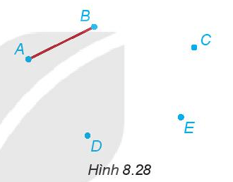

Lời giải:

+) Bắt đầu từ A hoặc B mỗi lần muốn đi đến một hòn đảo mới, ta cần một cây cầu bắc đến hòn đảo đó, do vậy cần xây thêm ít nhất 3 cây cầu.

+) Dưới đây là một mô hình thể hiện:

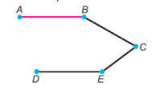

**Luyện Tập 2 trang 54 Toán lớp 6 Tập 2:**

Em hãy đo các đoạn thẳng trong Hình 8.33b rồi đánh dấu giống nhau cho các đoạn thẳng bằng nhau theo mẫu như Hình 8.33a.

```latex
\begin{tikzpicture}
  \draw[thick] (0,0) rectangle (4,3);
  \draw[thick] (0,0) -- (4,3);
  \draw[thick] (0,3) -- (4,0);
  \fill (0,0) circle (2pt) node[below left] {Q};
  \fill (4,0) circle (2pt) node[below right] {P};
  \fill (4,3) circle (2pt) node[above right] {N};
  \fill (0,3) circle (2pt) node[above left] {M};
\end{tikzpicture}
```

Lời giải:

+) Dùng thước đo các đoạn thẳng ta thấy: QM = PN = 3cm; QN = PM = 4cm.

```latex
\begin{tikzpicture}
  \draw[thick] (0,0) rectangle (4,3);
  \draw[thick] (0,0) -- (4,3);
  \draw[thick] (0,3) -- (4,0);
  \fill (0,0) circle (2pt) node[below left] {Q};
  \fill (4,0) circle (2pt) node[below right] {P};
  \fill (4,3) circle (2pt) node[above right] {N};
  \fill (0,3) circle (2pt) node[above left] {M};
  % Tick marks
  \node at (0,1.5) {-};
  \node at (4,1.5) {-};
  \node at (2,0) {|};
  \node at (2,3) {|};
\end{tikzpicture}
```

**Vận dụng 2 trang 54 Toán lớp 6 Tập 2:**

Dùng thước thẳng có chia vạch, em hãy đo chiều dài của cây bút em đang dùng.

So sánh chiều dài cây bút với chiều dài thước thẳng và rút ra kết luận.

Lời giải:

Sử dụng thước thẳng chia vạch để đo ta thấy: Chiều dài của cây bút bi khoảng 14 cm, chiều dài thước thẳng khoảng 20 cm.

Vì$14 < 16$nên chiều dài cây bút nhỏ hơn chiều dài thước thẳng.

**Bài 8.10trang 54 Toán lớp 6 Tập 2:**

Dùng compa vẽ đường tròn tâm O có bán kính bằng 2 cm. Gọi M và N là hai điểm tuỳ ý trên đường tròn đó. Hai đoạn thẳng OM và ON có bằng nhau không?

Lời giải:

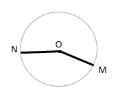

Ta thấy OM = ON = bán kính đường tròn tâm O = 2cm.

**Bài 8.11trang 54 Toán lớp 6 Tập 2:**

Việt dùng thước đo độ dài đoạn thẳng AB. Vì thước bị gãy mất một mẩu nên Việt chỉ có thể đặt thước để điểm A trùng với vạch 3 cm. Khi đó điểm B trùng với vạch 12 cm. Em hãy giúp Việt tính độ dài đoạn thẳng AB.

Lời giải:

Độ dài đoạn thẳng AB là:$12 – 3 = 9$(cm)

Vậy độ dài đoạn thẳng AB là 9 cm.

**Bài 8.12trang 54 Toán lớp 6 Tập 2:**

Nam dùng bước chân để đo chiều dài lớp học. Nam bước từ mép tường đầu lớp đến mép tường cuối lớp thì được đúng 18 bước chân. Nếu mỗi bước chân của Nam dài khoảng 0,6 m thì lớp học dài khoảng bao nhiêu mét?

Lời giải:

Lớp học dài khoảng:

$18. 0,6 = 10$, 8 (m)

Vậy lớp học dài khoảng 10,8m.

**Bài 8.13trang 54 Toán lớp 6 Tập 2:**

Hãy đo độ dài (đơn vị milimét) rồi sắp xếp các đoạn thẳng trong Hình 8.34theo thứ tự tăng dần của độ dài.

```latex
\begin{tikzpicture}
  \draw[thick] (0,2) -- (1,2);
  \fill (0,2) circle (2pt) node[left] {C};
  \fill (1,2) circle (2pt) node[right] {D};
  
  \draw[thick] (0,1) -- (4.2,1);
  \fill (0,1) circle (2pt) node[left] {A};
  \fill (4.2,1) circle (2pt) node[right] {B};
  
  \draw[thick] (0,0) -- (3,0);
  \fill (0,0) circle (2pt) node[left] {E};
  \fill (3,0) circle (2pt) node[right] {F};
\end{tikzpicture}
```

Lời giải:

Sau khi đo độ dài các đoạn thẳng có trong hình$8.34$, ta có:

CD = 10 mm; AB = 42 mm; EF = 21 mm; GH = 32 mm; IK = 53 mm

Vì$10 < 21 < 32 < 42 < 53$nên CD < EF < GH < AB < IK.

Vậy sắp xếp theo thứ tự tăng dần độ dài đoạn thẳng: CD; EF; GH; AB; IK.

**Bài 8.14trang 54 Toán lớp 6 Tập 2:**

Một cái cây đang mọc thẳng thì bị bão làm gãy phần ngọn. Người ta đo được phần ngọn bị gãy dài 1,75 m và phần thân còn lại dài 3m. Hỏi trước khi bị gãy, cây cao bao nhiêu mét?

Lời giải:

Trước khi bị gãy, chiều cao của cây là:

$3 + 1,75 = 4,75$(m)

Vậy trước khi gãy, cây cao 4,75 m.

## Bài 35. Trung điểm của đoạn thẳng
**Vận dụng trang 56 Toán lớp 6 Tập 2:**

Vòng quay mặt trời trong một khu vui chơi có điểm cao nhất là 60 m, điểm thấp nhất là 6 m (so với mặt đất). Hỏi trục của vòng quay nằm ở độ cao nào?

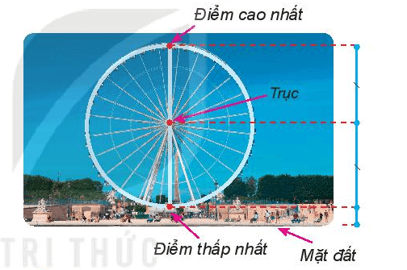

Lời giải:

Gọi D là điểm ở mặt đất, T là trục, M là điểm cao nhất, N là điểm thấp nhất như hình vẽ dưới, do vậy ta có MD = 60m; ND = 6m

```latex
\begin{tikzpicture}
  \draw[thick] (0,0) -- (0,6);
  \fill (0,0) circle (2pt) node[right] {D (mặt đất)};
  \fill (0,0.6) circle (2pt) node[right] {N (thấp nhất)};
  \fill (0,3.3) circle (2pt) node[right] {T (trục)};
  \fill (0,6) circle (2pt) node[right] {M (cao nhất)};
\end{tikzpicture}
```

Vì điểm N nằm giữa hai điểm M và D nên:

MN + ND = MD

MN = MD – ND

Thay số: MD = 60m; ND = 6m ta được:

MN =$60 – 6 = 54$m

Vì trục là tâm nên T là trung điểm MD do đó:

$TN = \frac{54}{2} = 27$ m

Vì N nằm giữa hai điểm T và D nên: TN + ND = TD

Thay số: TN = 27m; ND = 6m, ta có: TD =$27 + 6 = 33$(m)

Vậy trục của vòng quay nằm ở độ cao 33m so với mặt đất.

**Bài 8.15trang 56 Toán lớp 6 Tập 2:**

Cho hình vẽ sau:

```latex
\begin{tikzpicture}
  \draw[thick] (0,0) -- (4,0) -- (3,3) -- (1,2) -- cycle;
  \draw[thick] (0,0) -- (3,3); % AC
  \draw[thick] (4,0) -- (1,2); % BD
  \fill (1,2) circle (2pt) node[above left] {A};
  \fill (0,0) circle (2pt) node[below left] {B};
  \fill (4,0) circle (2pt) node[below right] {C};
  \fill (3,3) circle (2pt) node[above right] {D};
  \fill (1.8, 1.2) circle (2pt) node[above] {E};
\end{tikzpicture}
```

a) Em hãy dùng thước thẳng để kiểm tra xem điểm E có phải là trung điểm của đoạn AC không.

b) Kiểm tra xem E còn là trung điểm của đoạn thẳng nào khác có các đầu mút là các điểm đã cho.

Lời giải:

a) Sử dụng thước thẳng để đo ta thấy EA = EC

Vì E nằm giữa A và C mà AE = EC nên E là trung điểm của AC.

b)

```latex
\begin{tikzpicture}
  \draw[thick] (0,0) -- (4,0) -- (3,3) -- (1,2) -- cycle;
  \draw[thick] (0,0) -- (3,3); % AC
  \draw[thick] (4,0) -- (1,2); % BD
  \fill (1,2) circle (2pt) node[above left] {A};
  \fill (0,0) circle (2pt) node[below left] {B};
  \fill (4,0) circle (2pt) node[below right] {C};
  \fill (3,3) circle (2pt) node[above right] {D};
  \fill (1.8, 1.2) circle (2pt) node[above] {E};
\end{tikzpicture}
```

Ta nhận thấy ba điểm B, E, D cùng nằm trên một đường thẳng nên chúng thẳng hàng.

Sử dụng thước thẳng để đo ta thấy: BE = DE

Vì E nằm giữa B và D mà BE = ED nên E là trung điểm của BD.

**Bài 8.16trang 56 Toán lớp 6 Tập 2:**

Tính độ dài của đoạn thẳng AB nếu trung điểm I của đoạn thẳng AB nằm cách mút A một khoảng bằng 4,5 cm.

Lời giải:

Vì trung điểm I của AB nằm cách mút A một khoảng 4,5 cm nên ta có:

AB =$4,5. 2 = 9$(cm)

Vậy độ dài đoạn thẳng AB dài 9cm.

**Bài 8.17trang 56 Toán lớp 6 Tập 2:**

Cho hình vẽ sau. Biết C là trung điểm của đoạn thẳng AB, D là trung điểm của đoạn thẳng AC. Biết rằng CD = 2 cm, hãy tính độ dài đoạn thẳng AB.

```latex
\begin{tikzpicture}
  \draw[thick] (0,0) -- (8,0);
  \fill (0,0) circle (2pt) node[below] {A};
  \fill (2,0) circle (2pt) node[below] {D};
  \fill (4,0) circle (2pt) node[below] {C};
  \fill (8,0) circle (2pt) node[below] {B};
\end{tikzpicture}
```

Lời giải:

Vì D là trung điểm của đoạn thẳng AC nên ta có:

AC = DC.$2 = 2. 2 = 4$(cm)

Vì C là trung điểm của đoạn thẳng AB nên ta có:

AB = AC.$2 = 4. 2 = 8$(cm)

Vậy độ dài đoạn thẳng AB dài 8cm.

**Bài 8.18trang 56 Toán lớp 6 Tập 2:**

Giả sử em có một cây gậy và muốn tìm điểm chính giữa của cây gậy đó. Em sẽ làm thế nào:

a) Dùng thước đo độ dài;

b) Chỉ dùng một sợi dây đủ dài.

Lời giải:

a) Dùng thước đo độ dài tìm điểm chính giữa của cây gậy ta làm như sau:

- Dùng thước đo độ dài của cây gậy.

- Lấy kết quả đo đó chia đôi, ta được khoảng cách từ trung điểm cây gậy đến các đầu mút của cây gậy.

- Dùng thước đo lại với khoảng cách vừa tìm được ta xác định được trung điểm của cây gậy.

b) Dùng sợi dây để tìm điểm chính giữa của cây gậy ta làm như sau:

- Ta đặt sợi dây sao cho thu được một đoạn bằng độ dài của cây gậy

- Ta gập đoạn sợi dây đó lại sao cho hai đầu sợi dây trùng nhau. Nếp gập cắt sợi dây thành hai phần bằng nhau.

Sau đó ta đặt sợi dây vừa gập lên cây gậy ta sẽ tìm được điểm chia cây gậy thành hai phần bằng nhau đó chính là trung điểm của cây gậy.

## Luyện tập chung trang 57
**Bài 8.19trang 57 Toán lớp 6 Tập 2:**

Cho bốn điểm phân biệt A, B, C và D, trong đó không có ba điểm nào thẳng hàng.

a) Có bao nhiêu đường thẳng đi qua hai trong bốn điểm đã cho? Kể tên các đường thẳng đó.

b) Có bao nhiêu tia với gốc là một trong bốn điểm đã cho? Đó là những đoạn thẳng nào?

c) Có bao nhiêu đoạn thẳng có hai mút là hai trong bốn điêm đã cho? Đó là những đoạn thẳng nào?

Lời giải:

```latex
\begin{tikzpicture}
  \draw[thick] (0,0) -- (4,0) -- (3,3) -- (1,2) -- cycle;
  \draw[thick] (0,0) -- (3,3); % AC
  \draw[thick] (4,0) -- (1,2); % BD
  \fill (1,2) circle (2pt) node[above left] {A};
  \fill (0,0) circle (2pt) node[below left] {B};
  \fill (4,0) circle (2pt) node[below right] {C};
  \fill (3,3) circle (2pt) node[above right] {D};
\end{tikzpicture}
```

a) Có 6 đường thẳng đi qua hai trong bốn điểm đã cho

Tên các đường thẳng đó là: AB, AC, AD, BC, BD, CD.

b. Có 12 tia với gốc là một trong bốn điểm đã cho và đi qua một trong ba điểm còn lại

Đó là những tia: AB, AD, AC, BA, BC, BD, DA, DB, DC, CA, CB, CD.

c. Có 6 đoạn thẳng có hai mút là hai trong bốn điểm đã cho

Đó là những đoạn thẳng: AB, AD, AC, BC, BD, DC.

**Bài 8.20trang 57 Toán lớp 6 Tập 2:**

Cho ba điểm A, B, C cùng nằm trên đường thẳng d sao cho B nằm giữa A và C.

Hai điểm D và E không thuộc d và không cùng thẳng hàng với điểm nào trong các điểm A, B và C.

a) Có bao nhiêu đường thẳng, mỗi đường thẳng đi qua ít nhất hai trong năm điểm đã cho?

b) Tìm trên đường thẳng d điểm G sao cho ba điểm D, E, G thẳng hàng. Có phải khi nào cũng tìm được điểm G như thế hay không?

Lời giải:

a)

```latex
\begin{tikzpicture}
  \draw[thick] (-1,0) -- (5,0); % line with A,B,C
  \fill (0,0) circle (2pt) node[below] {A};
  \fill (2,0) circle (2pt) node[below] {B};
  \fill (4,0) circle (2pt) node[below] {C};
  
  \fill (1,3) circle (2pt) node[above] {D};
  \fill (3,2) circle (2pt) node[above] {E};
  
  \draw[thick] (1,3) -- (0,0);
  \draw[thick] (1,3) -- (2,0);
  \draw[thick] (1,3) -- (4,0);
  \draw[thick] (1,3) -- (3,2);
  \draw[thick] (3,2) -- (0,0);
  \draw[thick] (3,2) -- (2,0);
  \draw[thick] (3,2) -- (4,0);
\end{tikzpicture}
```

Có 8 đường thẳng là: AB (hay BC, AC); AD; AE; BD; BE; CD; CE; DE.

b)

Vẽ đường thẳng DE.

+) Nếu đường thẳng DE cắt đường thẳng d tại G thì ba điểm D, E, G thẳng hàng như hình vẽ dưới:

```latex
\begin{tikzpicture}
  \draw[thick] (-1,0) -- (5,0) node[right] {d};
  \draw[thick] (0,-1) -- (4,3);
  \fill (1,0) circle (2pt) node[below right] {G};
  \fill (2,1) circle (2pt) node[above left] {D};
  \fill (3,2) circle (2pt) node[above left] {E};
\end{tikzpicture}
```

+) Nếu đường thẳng DE song song với với d thì không tìm được được G nào thỏa mãn G nằm trên đường thẳng d mà D, E, G thẳng hàng, minh họa bởi hình vẽ:

```latex
\begin{tikzpicture}
  \draw[thick] (-1,0) -- (5,0) node[right] {d};
  \draw[thick] (-1,2) -- (5,2);
  \fill (1,2) circle (2pt) node[above] {D};
  \fill (4,2) circle (2pt) node[above] {E};
\end{tikzpicture}
```

**Bài 8.21trang 57 Toán lớp 6 Tập 2:**

Cho điểm M trên tia Om sao cho OM = 5 cm. Gọi N là điểm trên tia đối của tia Om và cách O một khoảng bằng 7cm.

a) Vẽ hình và tính độ dài đoạn thẳng MN.

b) Gọi K là trung điểm của đoạn thẳng MN. Tính độ dài các đoạn thẳng MK và OK.

c) Điểm K thuộc tia nào trong hai tia OM và ON?

Lời giải:

```latex
\begin{tikzpicture}
  \draw[thick, <->] (0,0) -- (7,0);
  \fill (1,0) circle (2pt) node[below] {N};
  \fill (3,0) circle (2pt) node[below] {O};
  \fill (4,0) circle (2pt) node[below] {K};
  \fill (6,0) circle (2pt) node[below] {M};
  \node[above] at (6.8,0) {m};
  \node[above] at (0.2,0) {n};
\end{tikzpicture}
```

a) Vì M, N là hai điểm thuộc hai tia đối nhau nên ta có điểm O nằm giữa hai điểm M và N nên ta có:

MN = ON + OM

Thay số: OM = 5cm; ON = 7cm nên MN =$5 + 7 = 12$(cm)

Vậy MN = 12cm.

b. Vì K là trung điểm của đoạn MN nên ta có:

KM = KN = MN:$2 = 12: 2 = 6$(cm)

Trên cùng mặt phẳng có bờ là tia đối của tia Om, ta có MO < MK$(5 < 6)$nên điểm O nằm giữa hai điểm M và K nên OK + OM = KM

Thay số: KM = 6 cm; OM = 5 cm, ta có:

OK +$5 = 6$

OK =$6 – 5 = 1$(cm)

Vậy MK = 6cm; OK = 1cm.

c. Trên nửa mặt phẳng có bờ là tia đối của tia Om có: OK < ON (do$1 < 7)$nên K thuộc tia ON.

**Bài 8.22trang 57 Toán lớp 6 Tập 2:**

Cho hai điểm phân biệt A và B cùng nằm trên tia Ox sao cho OA = 4 cm, OB = 6 cm. Gọi M là trung điểm của đoạn thẳng AB. Tính độ dài đoạn thẳng OM.

Lời giải:

```latex
\begin{tikzpicture}
  \draw[thick, ->] (0,0) -- (6,0) node[above] {x};
  \fill (0,0) circle (2pt) node[below] {O};
  \fill (2,0) circle (2pt) node[below] {A};
  \fill (3,0) circle (2pt) node[below] {M};
  \fill (4,0) circle (2pt) node[below] {B};
\end{tikzpicture}
```

Vì trên nửa mặt phẳng có bờ là tia Ox có OA < OB$(4 < 6)$nên điểm A nằm giữa hai điểm O và B nên ta có: OA + AB = OB

Thay số: OB = 6 cm ; A = 4 cm, ta được:

4 + AB = 6

AB =$6 – 4$

AB = 2 cm

Vì M là trung điểm của AB nên ta có: MA = MB = AB:$2=1$cm

Vì trên nửa mặt phẳng có bờ là tia Ox có: MB < BO$(1 < 6)$nên điểm M nằm giữa hai điểm O và B, ta có: OM + MB = OB

Thay số: MB =1 cm; OB = 6 cm ta được:

OM +$1 = 6$

OM =$6 – 1$

OM = 5cm

Vậy độ dài đoạn thẳng OM dài 5cm.

Hoặc ta có thể làm theo cách sau:

Trên nửa mặt phẳng có bờ là tia Ox có: Vì M là trung điểm của đoạn thẳng AB, A nằm giữa O và B nên A nằm giữa O và M. Khi đó, ta có: OA + MA = OM

Thay số: OA = 4 cm; MA = 1 cm ta được:

$4 + 1$= OM

OM = 5cm

Vậy độ dài đoạn thẳng OM dài 5cm.

**Bài 8.23trang 57 Toán lớp 6 Tập 2:**

Trong hình vẽ dưới đây, em hãy liệt kê tất cả các bộ ba điểm thẳng hàng.

```latex
\begin{tikzpicture}
  \draw[thick] (0,0) -- (5,0);
  \fill (1,0) circle (2pt) node[below] {A};
  \fill (2,0) circle (2pt) node[below] {C};
  \fill (3,0) circle (2pt) node[below] {N};
  \fill (4,0) circle (2pt) node[below] {B};
\end{tikzpicture}
```

Lời giải:

Các bộ ba điểm thẳng hàng là:

A, C, N

A, C, B

A, N, B

C, N, B

**Bài 8.24trang 57 Toán lớp 6 Tập 2:**

Em hãy vẽ 7 điểm trên một tờ giấy trắng sao cho có thể kẻ được 6 đường thẳng mà mỗi đường thẳng đều đi qua 3 trong 7 điểm đó.

Lời giải:

Gọi 7 điểm A, B, C, M, N, P và G như hình vẽ dưới:

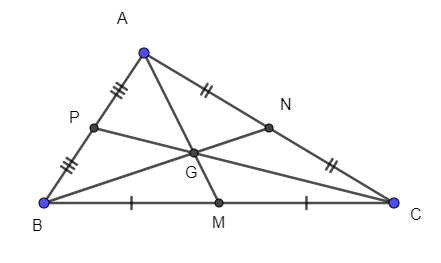

## Bài 36. Góc
**Luyện Tập 1 trang 59 Toán lớp 6 Tập 2:**

(1) Quan sát Hình 8.46và gọi tên các góc có đỉnh là A, B trong hình vẽ.

```latex
\begin{tikzpicture}
  \draw[thick] (0,0) -- (4,0) -- (3,3) -- (1,2) -- cycle;
  \draw[thick] (0,0) -- (3,3); % AC
  \draw[thick] (4,0) -- (1,2); % BD
  \fill (1,2) circle (2pt) node[above left] {A};
  \fill (0,0) circle (2pt) node[below left] {B};
  \fill (4,0) circle (2pt) node[below right] {C};
  \fill (3,3) circle (2pt) node[above right] {D};
\end{tikzpicture}
```

(2) Vẽ hình theo hướng dẫn sau:

- Vẽ đường thẳng xy

- Lấy điểm A thuộc đường thẳng xy.

- Lấy điểm B không thuộc đường thẳng xy.

- Nối A và B.

a) Em hãy đọc tên các góc có trong hình vừa vẽ;

b) Trong các góc đó, hãy chỉ ra góc bẹt.

Lời giải:

1)

+) Các góc ở đỉnh A là: Góc DAC; góc DAB; góc BAC.

+) Các góc ở đỉnh B là: Góc ABC; góc ABD; góc DBC.

2) Ta có hình vẽ:

```latex
\begin{tikzpicture}
  \draw[thick, <->] (0,0) -- (6,0); % xy
  \draw[thick] (2,-1) -- (4,3); % line BC
  \fill (3,1) circle (2pt) node[below right] {A};
  \fill (3.5,2) circle (2pt) node[above left] {B};
  \fill (2.5,0) circle (2pt) node[below left] {C};
  \node[above] at (0.2,0) {x};
  \node[above] at (5.8,0) {y};
\end{tikzpicture}
```

a) Các góc có trong hình vẽ là: $\widehat{xAB}, \widehat{yAB}, \widehat{xAC}, \widehat{yAC}$

b) Vì Ax và Ay là hai góc đối nhau nên $\widehat{xAy}$ là góc bẹt.

**Vận dụng 1 trang 59 Toán lớp 6 Tập 2:**

Compa là một dụng cụ học tập quen thuộc của các em học sinh. Mở chiếc compa ra ta thấy hình ảnh của một góc, trong đó hai cạnh của compa là hai cạnh của góc, đỉnh của compa là đỉnh của góc (H.$8.47)$.

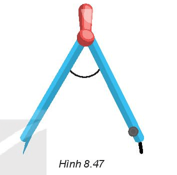

Em hãy tìm thêm trong thực tiễn các hình ảnh của góc và mô tả đỉnh, cạnh của các góc đó.

Lời giải:

Thực tiễn các hình ảnh của góc là:

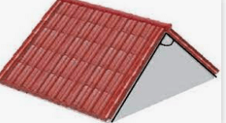

+) Hình ảnh trên thì cạnh của góc là hai đường thẳng viền của mái nhà, đỉnh là giao điểm của hai đường viền của mái nhà.


+) Hình ảnh trên thì cạnh của góc là kim dài và kim phút, đỉnh là tâm của đồng hồ.

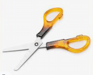

+) Hình ảnh trên là Chiếc kéo hai lưỡi kéo là cạnh của góc, trụ của kéo là đỉnh của góc.

**Luyện Tập 2 trang 60 Toán lớp 6 Tập 2:**

Vẽ Hình 8.50vào vở.

a) Kể tên các điểm nằm trong góc xOy,

b) Lấy điểm I thuộc đoạn thẳng AB, điểm K nằm trên đường thẳng AB nhưng không thuộc đoạn AB.

Hỏi điểm I có nằm trong góc xOy không? Điểm K có nằm trong góc xOy không?

```latex
\begin{tikzpicture}
  \draw[thick, ->] (0,0) -- (4,0) node[above] {x};
  \draw[thick, ->] (0,0) -- (3,3) node[right] {y};
  \fill (0,0) circle (2pt) node[below left] {O};
  \fill (2,0) circle (2pt) node[below] {A};
  \fill (2,2) circle (2pt) node[above left] {B};
  \fill (1.5,0.5) circle (2pt) node[below] {M};
  \fill (2.5,1) circle (2pt) node[below] {P};
\end{tikzpicture}
```

Lời giải:

a. Các điểm nằm trong góc xOy là: P; M.

b.

+) Nếu điểm I trùng với điểm A hoặc điểm B thì điểm I không nằm trong góc xOy.

```latex
\begin{tikzpicture}
  \draw[thick, ->] (0,0) -- (4,0) node[above] {x};
  \draw[thick, ->] (0,0) -- (3,3) node[right] {y};
  \fill (0,0) circle (2pt) node[below left] {O};
  \fill (2,0) circle (2pt) node[below] {A (I)};
  \fill (2,2) circle (2pt) node[above left] {B};
\end{tikzpicture}
```

+) Nếu điểm I nằm trên đoạn thẳng AB nhưng không trùng với A và B thì điểm I nằm trong góc xOy.

```latex
\begin{tikzpicture}
  \draw[thick, ->] (0,0) -- (4,0) node[above] {x};
  \draw[thick, ->] (0,0) -- (3,3) node[right] {y};
  \fill (0,0) circle (2pt) node[below left] {O};
  \fill (2,0) circle (2pt) node[below] {A};
  \fill (2,2) circle (2pt) node[above left] {B};
  \draw[thick, dashed] (2,0) -- (2,2);
  \fill (2,1) circle (2pt) node[right] {I};
\end{tikzpicture}
```

+) Nếu điểm K nằm trên đường thẳng AB nhưng không thuộc đoạn AB thì điểm K không nằm trong góc xOy.

```latex
\begin{tikzpicture}
  \draw[thick, ->] (0,0) -- (4,0) node[above] {x};
  \draw[thick, ->] (0,0) -- (3,3) node[right] {y};
  \fill (0,0) circle (2pt) node[below left] {O};
  \fill (2,0) circle (2pt) node[below] {A};
  \fill (2,2) circle (2pt) node[above left] {B};
  \draw[thick, dashed] (2,-1) -- (2,3);
  \fill (2,2.5) circle (2pt) node[right] {K};
\end{tikzpicture}
```

**Vận dụng 2 trang 60 Toán lớp 6 Tập 2:**

Quan sát mặt đồng hồ ở hình bên và cho biết trong các vạch chỉ số trên mặt đồng hồ, những vạch nào nằm trong góc tạo bởi:

a) Kim giờ và kim phút;

b) Kim giây và kim phút.


Lời giải:

a) Các vạch nằm trong góc tạo bởi kim giờ và kim phút là các vạch số: 11; 12; 1.

b) Các vạch nằm trong góc tạo bởi kim giây và kim phút là các vạch số: 9; 10; 11; 12; 1.

**Bài 8.25trang 60 Toán lớp 6 Tập 2:**

Viết tên (cách viết kí hiệu) của góc, chỉ ra đỉnh, cạnh của góc trong mỗi hình vẽ sau:

```latex
\begin{tikzpicture}
  % Hinh a
  \draw[thick, ->] (0,0) -- (2,0) node[right] {x};
  \draw[thick, ->] (0,0) -- (1.5,2) node[right] {y};
  \fill (0,0) circle (2pt) node[below] {M};
  \node at (1, -1) {a)};
  
  % Hinh b
  \begin{scope}[xshift=4cm]
    \draw[thick] (0,0) -- (3,0) -- (1.5, 2) -- cycle;
    \fill (0,0) circle (2pt) node[below left] {E};
    \fill (3,0) circle (2pt) node[below right] {F};
    \fill (1.5,2) circle (2pt) node[above] {D};
    \node at (1.5, -1) {b)};
  \end{scope}
\end{tikzpicture}
```

Lời giải:

+) Hình a: Góc xMy kí hiệu $\widehat{xMy}$ , đỉnh là M, hai cạnh của góc là My và Mx.

+) Hình b:

Góc DEF kí hiệu $\widehat{DEF}$ , đỉnh là E, hai cạnh của góc là ED và EF

Góc EDF kí hiệu $\widehat{EDF}$ , đỉnh là D, hai cạnh của góc là DE và DF

Góc DFE kí hiệu $\widehat{DFE}$ , đỉnh là F, cạnh của góc là FD và FE.

**Bài 8.26trang 60 Toán lớp 6 Tập 2:**

Cho đường thẳng xy. Vẽ hai điểm A, B nằm trên đường thẳng xy. Gọi tên các góc bẹt tạo thành.

Lời giải:

+) Vì Ax và Ay hay Ax và AB là hai tia đối nhau nên $\widehat{xAy}$ (hay $\widehat{xAB}$ ) là góc bẹt.

+) Vì Bx và By hay BA và By là hai tia đối nhau nên $\widehat{xBy}$ (hay $\widehat{ABy}$ ) là góc bẹt.

**Bài 8.27trang 60 Toán lớp 6 Tập 2:**

Quan sát mặt đồng hồ dưới đây.


Trong các vạch chỉ số trên mặt đồng hồ, những vạch nào nằm trong góc tạo bởi kim giờ và kim phút khi đồng hồ chỉ 8 giờ 15 phút?

Lời giải:

Trong các vạch chỉ số trên mặt đồng hồ, những vạch nằm trong góc tạo bởi kim giờ và kim phút khi đồng hồ chỉ 8 giờ 15 phút (kim giờ chỉ qua số 8 nhưng chưa đến số 9, còn kim phút chỉ đúng số 3) là vạch chỉ các số 4; 5; 6; 7; 8.

**Bài 8.28trang 60 Toán lớp 6 Tập 2:**

Cho ba tia chung gốc Oa, Ob và Oc, trong đó không có hai tia nào đối nhau. Hỏi có bao nhiêu góc có hai cạnh là hai trong ba tia đã cho?

Lời giải:

```latex
\begin{tikzpicture}
  \draw[thick, ->] (0,0) -- (3,0) node[right] {x};
  \draw[thick, ->] (0,0) -- (2,2) node[right] {y};
  \draw[thick, ->] (0,0) -- (-1,2.5) node[left] {z};
  \fill (0,0) circle (2pt) node[below] {O};
\end{tikzpicture}
```

Có 3 góc là: $\widehat{xOy}, \widehat{yOz}, \widehat{xOz}$

**Bài 8.29trang 60 Toán lớp 6 Tập 2:**

Viết tên các góc có đỉnh A, đỉnh M trong hình vẽ sau:

```latex
\begin{tikzpicture}
  \draw[thick] (0,0) -- (6,0);
  \draw[thick] (0,0) -- (3,3) -- (6,0);
  \draw[thick] (3,3) -- (4,0);
  \fill (0,0) circle (2pt) node[below left] {A};
  \fill (4,0) circle (2pt) node[below] {B};
  \fill (6,0) circle (2pt) node[below right] {C};
  \fill (3,3) circle (2pt) node[above] {M};
\end{tikzpicture}
```

Lời giải:

+) Các góc ở đỉnh A là: $\widehat{MAC}, \widehat{MAB}$ ; $\widehat{CAB}$

+) Các góc ở đỉnh M là: $\widehat{AMB}, \widehat{AMC}, \widehat{BMC}$

**Bài 8.30trang 60 Toán lớp 6 Tập 2:**

Lấy ba điểm không thẳng hàng A, B, C trên tờ giấy trắng rồi vẽ các đoạn thẳng AB, BC, CA.

Em hãy tô màu phần hình chứa tất cả các điểm trong của của ba góc BAC, ACB, CBA.

Lời giải:

```latex
\begin{tikzpicture}
  \fill[cyan!20] (0,0) -- (4,0) -- (2,3) -- cycle;
  \draw[thick] (0,0) -- (4,0) -- (2,3) -- cycle;
  \fill (0,0) circle (2pt) node[below left] {A};
  \fill (4,0) circle (2pt) node[below right] {B};
  \fill (2,3) circle (2pt) node[above] {C};
\end{tikzpicture}
```

Phần tô màu xanh là phần hình chứa tất cả các điểm trong của ba góc BAC, ACB, CBA.

## Bài 37. Số đo góc
**Luyện Tập 1 trang 62 Toán lớp 6 Tập 2:**

(1) Dùng thước đo góc, em hãy đo và viết số đo của các góc trong mỗi hình sau.

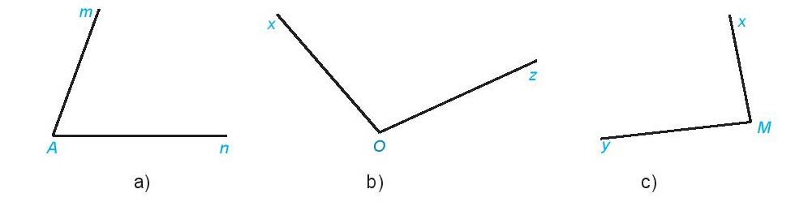

(2) Em hãy đo góc sút trong Hình 8.42, Bài Góc.

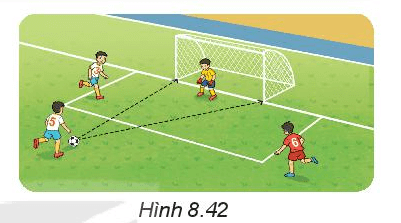

Lời giải:

1) Dùng thước đo góc ta được kết quả:

a. Số đo góc nAm là: 70 độ, ta viết: 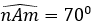

b. Số đo góc xOz là: 105 độ, ta viết: 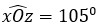

c. Số đo góc xMy là: 85 độ, ta viết: 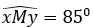

2) Dùng thước đo góc ta được kết quả:

Số đo của góc sút là: 20 độ

**Luyện Tập 2 trang 63 Toán lớp 6 Tập 2:**

Hãy sắp xếp các góc sau theo thứ tự số đo từ bé đến lớn: góc vuông, góc nhọn, góc tù và góc bẹt.

Lời giải:

+) Góc vuông có số đo bằng 90^{0}

+) Góc nhọn có số đo lớn hơn 0^{0} và nhỏ hơn 90^{0}

+) Góc tù là góc có số đo lớn hơn 90^{0}và nhỏ hơn 180^{0}

+) Góc bẹt là góc có số đo bằng 180^{0}

Do đó sắp xếp các góc theo thứ tự số đo từ bé đến lớn là: góc nhọn, góc vuông, góc tù, góc vuông.

**Vận dụng 2 trang 63 Toán lớp 6 Tập 2:**

a) Dùng thước đo góc để đo các góc tạo bởi kim phút và kim giờ trong các mặt đồng hồ sau:


b) Trong các góc đó, chỉ ra góc vuông, góc nhọn, góc tù, góc bẹt.

Lời giải:

a. Dùng thước đo góc, ta thấy số đo của các góc tạo bởi kim phút và kim giờ trong các mặt đồng hồ trên theo thứ tự từ trái qua phải lần lượt là: 120^{0}; 90^{0} ; 180^{0} ; 60^{0}

b.

Góc vuông là góc có số đo bằng 90^{0}


Góc nhọn là góc 30^{0} vì$0^{0} < 30^{0}<90^{0}$


Góc tù là góc 120^{0} vì$90^{0} < 120^{0}$.< 180^{0}


Góc bẹt là góc 180^{0}


**Bài 8.31trang 64 Toán lớp 6 Tập 2:**

Cho các góc với số đo như dưới đây.

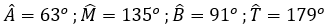

Trong các góc đó, kể tên các góc nhọn, góc tù.

Lời giải:

+) Các góc nhọn là góc có số đo lớn hơn 0^{0} và nhỏ hơn 90^{0} là: 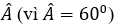

+) Các góc tù là góc có số đo lớn hơn 90^{0} và nhỏ hơn 180^{0} là: 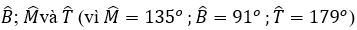

**Bài 8.32trang 64 Toán lớp 6 Tập 2:**

Quan sát hình sau.

```latex
\begin{tikzpicture}
  \begin{scope}[xshift=0cm]
    \draw[thick] (0,0) -- (1.5,0);
    \draw[thick] (0,0) -- (1,1);
    \node at (0.75, -0.5) {Hình 1};
  \end{scope}
  \begin{scope}[xshift=2.5cm]
    \draw[thick] (0,0) -- (1.5,0);
    \draw[thick] (0,0) -- (0,1.5);
    \draw (0.3,0) -- (0.3,0.3) -- (0,0.3);
    \node at (0.75, -0.5) {Hình 2};
  \end{scope}
  \begin{scope}[xshift=5cm]
    \draw[thick] (0,0) -- (1.5,0);
    \draw[thick] (0,0) -- (1.2,0.5);
    \node at (0.75, -0.5) {Hình 3};
  \end{scope}
  \begin{scope}[xshift=7.5cm]
    \draw[thick] (0,0) -- (1.5,0);
    \draw[thick] (0,0) -- (-1,1);
    \node at (0.25, -0.5) {Hình 4};
  \end{scope}
  \begin{scope}[xshift=10cm]
    \draw[thick] (-1,0) -- (1.5,0);
    \fill (0,0) circle (2pt);
    \node at (0.25, -0.5) {Hình 5};
  \end{scope}
\end{tikzpicture}
```

a) Ước lượng bằng mắt xem góc nào là góc nhọn, góc vuông, góc tù, góc bẹt;

b) Dùng ê ke để kiểm tra lại kết quả của câu a;

c) Dùng thước đo góc để tìm số đo của mỗi góc.

Lời giải:

a) Ta kí hiệu các hình như dưới đây:

```latex
\begin{tikzpicture}
  \begin{scope}[xshift=0cm]
    \draw[thick] (0,0) -- (1.5,0);
    \draw[thick] (0,0) -- (1,1);
    \node at (0.75, -0.5) {Hình 1 (Góc nhọn)};
  \end{scope}
  \begin{scope}[xshift=3cm]
    \draw[thick] (0,0) -- (1.5,0);
    \draw[thick] (0,0) -- (0,1.5);
    \draw (0.3,0) -- (0.3,0.3) -- (0,0.3);
    \node at (0.75, -0.5) {Hình 2 (Góc vuông)};
  \end{scope}
  \begin{scope}[xshift=6cm]
    \draw[thick] (0,0) -- (1.5,0);
    \draw[thick] (0,0) -- (1.2,0.5);
    \node at (0.75, -0.5) {Hình 3 (Góc nhọn)};
  \end{scope}
  \begin{scope}[xshift=9cm]
    \draw[thick] (0,0) -- (1.5,0);
    \draw[thick] (0,0) -- (-1,1);
    \node at (0.25, -0.5) {Hình 4 (Góc tù)};
  \end{scope}
  \begin{scope}[xshift=12cm]
    \draw[thick] (-1,0) -- (1.5,0);
    \fill (0,0) circle (2pt);
    \node at (0.25, -0.5) {Hình 5 (Góc bẹt)};
  \end{scope}
\end{tikzpicture}
```

Ước lượng bằng mắt ta nhận thấy:

+) Góc nhọn: hình 1, hình 3

+) Góc vuông: hình 2

+) Góc tù: hình 4

+) Góc bẹt: hình 5

b) Dùng eke có góc 90^{0} để kiểm tra lại kết quả câu a) ta thấy kết quả dự đoán đúng.

c) Góc CEB có số đo là: 30 độ

Góc xAy có số đo là: 90 độ

Góc NIM có số đo là: 80 độ

Góc tAu có số đo là: 120 độ

Góc mEn có số đo là: 180 độ

**Bài 8.33trang 64 Toán lớp 6 Tập 2:**

Quan sát hình ảnh mặt đồng hồ, em hãy tìm một thời điểm mà góc tạo bởi kim giờ và kim phút là:

a) Góc nhọn; b) Góc vuông;

c) Góc tù; d) Góc bẹt.

Lời giải:

Thời điểm mà góc tạo bởi kim giờ và kim phút:

a) Đồng hồ chỉ 2 giờ là góc nhọn ( vì là góc 60^{0})


b) Đồng hồ chỉ 3 giờ là góc vuông (vì là góc 90^{0})


c) Đồng hồ chỉ 5 giờ là góc tù (vì là góc 150^{0})


d) Đồng hồ chỉ 6 giờ là góc bẹt (vì là góc 180^{0})


**Bài 8.34trang 64 Toán lớp 6 Tập 2:**

Đo các góc của tứ giác ABCD rồi tính tổng số đo của các góc đó.

```latex
\begin{tikzpicture}
  \draw[thick] (0,0) -- (4,0) -- (3,3) -- (1,2) -- cycle;
  \fill (1,2) circle (2pt) node[above left] {A};
  \fill (0,0) circle (2pt) node[below left] {B};
  \fill (4,0) circle (2pt) node[below right] {C};
  \fill (3,3) circle (2pt) node[above right] {D};
\end{tikzpicture}
```

Lời giải:

Dùng thước đo góc ta thấy:

```latex
\begin{tikzpicture}
  \draw[thick] (0,0) -- (4,0) -- (3,3) -- (1,2) -- cycle;
  \fill (1,2) circle (2pt) node[above left] {A};
  \fill (0,0) circle (2pt) node[below left] {B};
  \fill (4,0) circle (2pt) node[below right] {C};
  \fill (3,3) circle (2pt) node[above right] {D};
  \node at (1.3, 1.8) {$150^\circ$};
  \node at (0.4, 0.3) {$100^\circ$};
  \node at (3.5, 0.3) {$50^\circ$};
  \node at (2.8, 2.5) {$60^\circ$};
\end{tikzpicture}
```

Tổng số đo các góc đó là:$150^{0} + 100^{0} + 50^{0} +60^{0} = 360^{0}$

## Luyện tập chung trang 65
**Bài 8.35trang 66 Toán lớp 6 Tập 2:**

Hãy dùng ê ke để kiểm tra và cho biết góc nào là góc nhọn, góc vuông, góc tù, góc bẹt có trong hình sau.

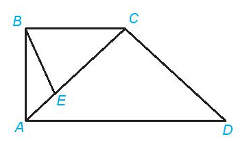

Lời giải:

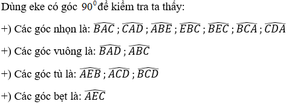

**Bài 8.36trang 66 Toán lớp 6 Tập 2:**

Trong hình vẽ sau, cho tam giác đều ABC và góc DBC bằng 20°.

```latex
\begin{tikzpicture}
  \draw[thick] (0,0) -- (4,0) -- (2,3.464) -- cycle;
  \draw[thick] (0,0) -- (3,1); % BD where DBC = 20
  \fill (0,0) circle (2pt) node[below left] {B};
  \fill (4,0) circle (2pt) node[below right] {C};
  \fill (2,3.464) circle (2pt) node[above] {A};
  \fill (3,1) circle (2pt) node[right] {D};
  \node at (1, 0.2) {$20^\circ$};
\end{tikzpicture}
```

a) Kể tên các góc trong hình vẽ trên. Những góc nào có số đo bằng 60°?

b) Điểm D có nằm trong góc ABC không? Điểm C có nằm trong góc ADB không?

c) Em hãy dự đoán số đo góc ABD và sử dụng thước đo góc để kiểm tra lại dự đoán của mình.

Lời giải:

```latex
\begin{tikzpicture}
  \draw[thick] (0,0) -- (4,0) -- (2,3.464) -- cycle;
  \draw[thick] (0,0) -- (3,1); % BD
  \fill (0,0) circle (2pt) node[below left] {B};
  \fill (4,0) circle (2pt) node[below right] {C};
  \fill (2,3.464) circle (2pt) node[above] {A};
  \fill (3,1) circle (2pt) node[right] {D};
  \node at (1, 0.2) {$20^\circ$};
  \node at (0.6, 0.7) {$40^\circ$};
\end{tikzpicture}
```

**Bài 8.37trang 66 Toán lớp 6 Tập 2:**

Cho hình vuông MNPQ và số đo các góc ghi tương ứng như trên hình sau.

a) Kể tên các điểm nằm trong góc AMC;

b) Cho biết số đo của góc AMC bằng cách đo;

c) Sắp xếp các góc NMA, AMC và CMQ theo thứ tự số đo tăng dần.

```latex
\begin{tikzpicture}
  \draw[thick] (0,0) rectangle (4,4);
  \draw[thick] (0,4) -- (4,0); % MQ to NP? No, MNPQ square. M top-left, N top-right, P bot-right, Q bot-left?
  % Text: "M, N, P, Q"
  \fill (0,4) circle (2pt) node[above left] {M};
  \fill (4,4) circle (2pt) node[above right] {N};
  \fill (4,0) circle (2pt) node[below right] {P};
  \fill (0,0) circle (2pt) node[below left] {Q};
  
  \fill (0,2) circle (2pt) node[left] {A};
  \fill (2,0) circle (2pt) node[below] {C};
  \draw[thick] (0,4) -- (0,2);
  \draw[thick] (0,4) -- (2,0);
\end{tikzpicture}
```

Lời giải:

a) Các điểm nằm trong góc AMC là: P

```latex
\begin{tikzpicture}
  \draw[thick] (0,0) rectangle (4,4);
  \fill (0,4) circle (2pt) node[above left] {M};
  \fill (4,4) circle (2pt) node[above right] {N};
  \fill (4,0) circle (2pt) node[below right] {P};
  \fill (0,0) circle (2pt) node[below left] {Q};
  
  \fill (0,2) circle (2pt) node[left] {A};
  \fill (2,0) circle (2pt) node[below] {C};
  \draw[thick] (0,4) -- (0,2);
  \draw[thick] (0,4) -- (2,0);
\end{tikzpicture}
```

**Bài 8.38trang 66 Toán lớp 6 Tập 2:**

Trong hình bên, góc xOy là góc nghiêng khi đặt thang. Biết rằng góc nghiêng khi đặt thang đảm bảo an toàn là khoảng 75°, em hãy đo góc xOy để kiểm tra xem chiếc thang ở hình bên đã đảm bảo an toàn hay chưa.

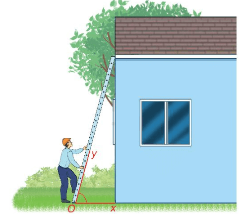

Lời giải:

Sử dụng thước đo góc ta đo được: $\widehat{xOy} = 75^\circ$

Vậy chiếc thang ở hình bên đã đảm bảo an toàn.

## Bài tập ôn cuối chương 8
**Bài 8.39trang 67 Toán lớp 6 Tập 2:**

Xem Hình 8.55rồi cho biết trong các khẳng định sau, khẳng định nào đúng, khẳng định nào sai?

```latex
\begin{tikzpicture}
  \draw[thick] (0,0) -- (6,0) node[right] {d};
  \draw[thick] (1,-1) -- (5,3); % line intersecting at (3,1) - wait, F is on d, so intersecting at (2.5, 0)
  % Let's make it intersect at (3,0) which is F
  \draw[thick] (2,-1) -- (4,2); 
  % Wait, F is on d. F is at (2.5, 0).
  % Line equation: passes through (2.5,0). Let's use (1,-1.5) to (4, 1.5).
  \fill (1,0) circle (2pt) node[below] {C};
  \fill (2.5,0) circle (2pt) node[below right] {F};
  \fill (3.5, 1) circle (2pt) node[above left] {A};
  \fill (1.5, -1) circle (2pt) node[below right] {B};
\end{tikzpicture}
```

a) Điểm C thuộc đường thẳng d, hai điểm A và B không thuộc đường thẳng d;

b) Ba điểm A, B, C không thẳng hàng;

c) Điểm F không thuộc đường thẳng m;

d) Ba điểm D, E, F không thẳng hàng.

Lời giải:

a) Vì điểm C nằm trên đường thẳng d, hai điểm A và B không nằm trên đường thẳng d nên kết luận *đúng.*

b) Vì ba điểm A, B, C không cùng nằm trên một đường thẳng nên ba điểm A, B, C không thẳng hàng là *đúng.*

c) Khẳng định là *đúng* vì điểm F không nằm trên đường thẳng m.

d) Vì ba điểm D, E, F không cùng nằm trên một đường thẳng nên ba điểm D, E, F không thẳng hàng là khẳng định *đúng*.

**Bài 8.40trang 67 Toán lớp 6 Tập 2:**

Hình 8.56thể hiện các quan hệ nào nếu nói về:

```latex
\begin{tikzpicture}
  \draw[thick] (0,0) -- (5,0);
  \fill (1,0) circle (2pt) node[below] {A};
  \fill (2.5,0) circle (2pt) node[below] {B};
  \fill (4,0) circle (2pt) node[below] {C};
\end{tikzpicture}
```

a) Ba điểm A, B và C?

b) Hai tia BA và BC?

c) Ba đoạn thẳng AB, BC và AC?

Lời giải:

a) Ba điểm A, B và C thẳng hàng; điểm B nằm giữa hai điểm A và C.

b) Hai tia BA và BC là hai tia đối nhau

c) Ba đoạn thẳng AB, BC và AC cùng nằm trên một đường thẳng và

AC = AB + BC.

**Bài 8.41trang 67 Toán lớp 6 Tập 2:**

Lời giải:

```latex
\begin{tikzpicture}
  \draw[thick] (0,0) -- (7,0);
  \fill (0,0) circle (2pt) node[below] {M};
  \fill (3.5,0) circle (2pt) node[below] {O};
  \fill (7,0) circle (2pt) node[below] {N};
  \node[above] at (1.75,0) {3.5 cm};
  \node[above] at (5.25,0) {3.5 cm};
\end{tikzpicture}
```

Vì O là trung điểm của MN nên $OM = ON = \frac{MN}{2} = \frac{7}{2} = 3.5$ cm nên ta xác định được trung điểm O như trên (cách M một đoạn bằng 3,5 cm)

**Bài 8.42trang 67 Toán lớp 6 Tập 2:**

Cho hình thang ABCD như hình vẽ bên. Em hãy:

a) Kể tên các góc có trong hình vẽ;

b) Đo rồi chỉ ra các góc nhọn, góc tù.

```latex
\begin{tikzpicture}
  \draw[thick, ->] (0,0) -- (3,0) node[right] {a};
  \draw[thick, ->] (0,0) -- (0,3) node[above] {c};
  \draw[thick, ->] (0,0) -- (2.12,2.12) node[right] {b};
  \fill (0,0) circle (2pt) node[below left] {O};
\end{tikzpicture}
```

Lời giải:

a) Các góc có trong hình vẽ trên là: $\widehat{aOb}, \widehat{bOc}, \widehat{aOc}$

b) Sử dụng thước đo góc ta có: $\widehat{aOb} = 45^\circ; \widehat{bOc} = 45^\circ; \widehat{aOc} = 90^\circ$

Do đó:

Góc nhọn: $\widehat{aOb}, \widehat{bOc}$. Góc vuông: $\widehat{aOc}$

**Bài 8.43trang 67 Toán lớp 6 Tập 2:**

Cho Hình 8.57.

```latex
\begin{tikzpicture}
  \draw[thick, <->] (-3,0) -- (3,0);
  \node[right] at (3,0) {x};
  \node[left] at (-3,0) {y};
  \draw[thick, ->] (0,0) -- (0,3) node[above] {z};
  \fill (0,0) circle (2pt) node[below left] {O};
\end{tikzpicture}
```

a) Kể tên các tia có trong hình trên. Trong đó, hai tia nào là hai tia đối nhau?

b) Kể tên các góc vuông, góc bẹt trong Hình 8.57;

c) Nếu điểm B nằm trong góc yOz thì góc xOB là góc tù hay góc nhọn?

Lời giải:

a) Các tia có trong hình bên là: Ox; Oy; Oz

Hai tia đối nhau là: tia Ox và tia Oy

```latex
\begin{tikzpicture}
  \draw[thick, <->] (-3,0) -- (3,0);
  \node[right] at (3,0) {x};
  \node[left] at (-3,0) {y};
  \draw[thick, ->] (0,0) -- (0,3) node[above] {z};
  \fill (0,0) circle (2pt) node[below left] {O};
\end{tikzpicture}
```
