## Bài 38. Dữ liệu và thu thập dữ liệu
**Luyện Tập 1 trang 69 Toán lớp 6 Tập 2:**

Cho hai dãy dữ liệu như sau:

(1) Số học sinh các lớp 6 trong trường:

35 42 87 38 40 41 38.

(2) Tên món ăn yêu thích của các thành viên trong gia đình:

Bánh chưng, pizza, canh cua, gà rán, rau muống luộc, cá kho, rượu vang.

a) Trong các dãy dữ liệu trên, dãy nào là dãy số liệu?

b) Hãy tìm dữ liệu không hợp lí (nếu có) trong mỗi dãy dữ liệu trên.

Lời giải:

a) Dãy số liệu là dãy (1): 35 42 87 38 40 41 38

b)

(1) Theo quy định, mỗi lớp ở bậc THCS thường có không quá 45 học sinh. Thực tế, do điều kiện khó khăn một số lớp có số học sinh nhiều hơn 45 nhưng không lớp nào có 87 học sinh. Do đó 87 là số liệu không hợp lí.

(2) “Rượu vang” là dữ liệu không hợp lí vì đây không phải là tên món ăn mà là tên một loại đồ uống.

**Luyện Tập 2 trang 71 Toán lớp 6 Tập 2:**

Dựa vào bảng Hoa điểm tốt tháng Ba (H.9.1), hãy lập bảng số điểm 8 của các bạn trong tổ Một theo mẫu như hình bên.

Ngoài thông tin này, em còn thu được những thông tin nào khác từ bảng đó?

| Tên | Số điểm 8 |
| --- | --- |
| Nam Anh | |
| Thanh Hằng | |
| Đức Minh | |

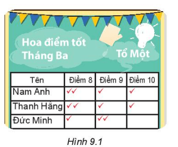

Lời giải:

Từ bảng Hoa điểm tốt tháng Ba (Hình 9.1) ta có: Số điểm 8 của Nam Anh, Thanh Hằng, Đức Minh lần lượt là 2; 2; 1

Do đó ta có bảng:

| Tên | Số điểm 8 |
| --- | --- |
| Nam Anh | 2 |
| Thanh Hằng | 2 |
| Đức Minh | 1 |

Từ bảng Hoa điểm tốt còn có thể thu được thông tin về số điểm 9, số điểm 10 của ba bạn trong tổ Một.

**Bài 9.1 trang 72 Toán lớp 6 Tập 2:**

Trong các dữ liệu sau, dữ liệu nào là số liệu, dữ liệu nào không phải là số liệu?

(1) Cân nặng của trẻ sơ sinh ( đơn vị tính là gam)

(2) Quốc tịch của học sinh trong một trường quốc tế;

(3) Chiều cao trung bình của một số loại cây thân gỗ ( đơn vị tính là mét)

Lời giải:

(1). Cân nặng của trẻ sơ sinh được biểu thị bằng số như 2700 gam, 3200 gam, … nên dữ liệu này là số liệu

(2). Quốc tịch của các bạn trong một trường quốc tế, chẳng hạn như: Việt Nam, Hàn Quốc, Nhật Bản, Anh, Nga,… Do đó dữ liệu này không là số liệu.

(3). Chiều cao trung bình của một số loại cây thân gỗ như là: 3m, 2,5 m, 1,2m, … Do đó dữ liệu này là số liệu.

**Bài 9.2 trang 72 Toán lớp 6 Tập 2:**

Bản tin sau được trích từ báo điện tử Vietnamnet ngày 18-3-2020:

"Như vậy, chỉ trong 12 ngày, Việt Nam đã ghi nhận thêm 60 ca mắc mới Covid -19, trong đó có 24 người nước ngoài. Hiện Hà Nội là địa phương có nhiều ca mắc mới nhất, với 20 trường hợp, kế đó là Bình Thuận 9 ca, Thành phố Hồ Chí Minh 9 ca"

Thay dấu "?" trong bảng sau bằng số liệu thống kê sốca mắc mới Covid -19 tại các địa phương tính đến ngày 18-3-2020.

| Địa phương | Số ca mắc mới Covid-19 |
| --- | --- |
| Hà Nội | ? |
| Bình Thuận | ? |
| Thành phố Hồ Chí Minh | ? |

Lời giải:

Vì Hà Nội có 20 ca, Bình Thuận có 9 ca, Thành phố Hồ Chí Minh có 9 ca mắc Covid – 19 nên ta có bảng sau:

| Địa phương | Số ca mắc mới Covid-19 |
| --- | --- |
| Hà Nội | 20 |
| Bình Thuận | 9 |
| Thành phố Hồ Chí Minh | 9 |
| | |
| --- | --- |

**Bài 9.3 trang 72 Toán lớp 6 Tập 2:**

Bảng sau cho biết số anh chị em ruột trong gia đình của 35 học sinh lớp 6A.

| Số anh chị em ruột | 0 | 1 | 2 | 3 |
| --- | --- | --- | --- | --- |
| Số học sinh | 18 | 12 | 5 | 1 |

Hãy tìm điểm không hợp lí trong bảng thống kê trên.

Lời giải:

Tổng số học sinh trong bảng thống kê trên là:

18 + 12 + 5 + 1 = 36 (học sinh)

Mà lớp 6A có 35 học sinh nên điều này là không hợp lí.

**Bài 9.4 trang 72 Toán lớp 6 Tập 2:**

Hãy tìm dữ liệu không hợp lí ( nếu có) trong dãy dữ liệu sau.

Thủ đô của một số quốc gia châu Á:

Hà Nội, Bắc Kinh, Paris, Tokyo, Đà Nẵng

Lời giải:

Dữ liệu không hợp lý là:

+) Đà Nẵng vì Đà Nẵng không là thủ đô của quốc gia châu Á nào.

+) Paris vì Paris là thủ đô của Pháp không thuộc châu Á.

**Bài 9.5 trang 72 Toán lớp 6 Tập 2:**

Để hoàn thành bảng sau, em sẽ sử dụng phương pháp thu thập dữ liệu nào?

| Cây | Môi trường sống | Dạng thân | Kiểu lá |
| --- | --- | --- | --- |
| Đậu | | | |
| Bèo tây | | | |

Lời giải:

Để hoàn thiện bảng, ta sử dụng phương pháp thu nhập dữ liệu từ: SGK, sách, báo, hỏi thầy cô, bố mẹ, quan sát, thí nghiệm, lấy thông tin từ những nguồn có sẵn...

**Bài 9.6 trang 72 Toán lớp 6 Tập 2:**

Hãy lập phiếu hỏi để thu thập dữ liệu về phương tiện đến trường của các thầy, cô giáo trong trường em.

Lời giải:

Có nhiều cách tạo phiếu hỏi khác nhau, dưới đây là một ví dụ:

PHIẾU HỎI

Thầy (cô) đi phương tiện gì đến trường?

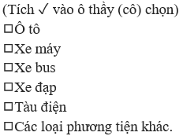

## Bài 39. Bảng thống kê và biểu đồ tranh
**Luyện Tập 1 trang 74 Toán lớp 6 Tập 2:**

(1) Cho các loại cây: bưởi, lúa, hồng xiêm, tỏi, hoa huệ, mít, ổi. Hãy xác định loại rễ (rễ cọc, rễ chùm) của mỗi cây rồi lập bảng thông kê về số lượng cây theo loại rễ.

(2) Trong một kì thi quốc tế, các thành viên đội tuyển Việt Nam đạt được số điểm lần lượt là:

26 18 36 28 21 32

Biết rằng người ta phân loại huy chương theo điểm số như sau:

Từ 15 đến dưới 24 điểm: Huy chương đồng;

Từ 24 đến dưới 31 điểm: Huy chương bạc;

Từ 31 điểm trở lên: Huy chương vàng.

Em hãy lập bảng thống kê số lượng huy chương của đội tuyển Việt Nam trong kì thi này theo mẫu sau:

| Huy chương | Vàng | Bạc | Đồng |
| --- | --- | --- | --- |
| Số học sinh | | | |

Lời giải:

1) Theo sách báo, hoặc tìm hiểu trên Internet, ta có:

Rễ cọc : bưởi , hồng xiêm , mít , ổi

Rễ chùm : lúa ; tỏi ; hoa huệ.

Ta có bảng thống kê:

| Loại rễ | Rễ cọc | Rễ chùm |
| --- | --- | --- |
| Số lượng cây | 4 | 3 |

2)

+) Điểm từ 15 đến dưới 24 điểm là: điểm 18; 21 (huy chương đồng)

+) Từ 24 đến dưới 31 điểm là: điểm 26; 28 (huy chương bạc)

+) Từ 31 điểm trở lên là: điểm 32; 36 (huy chương vàng)

Do đó ta có bảng thống kê sau:

| Huy chương | Vàng | Bạc | Đồng |
| --- | --- | --- | --- |
| Số học sinh | 2 | 2 | 2 |

**Luyện Tập 2 trang 75 Toán lớp 6 Tập 2:**

Biểu đồ tranh ở bên cho biết món ăn sáng yêu thích của các bạn trong lớp.

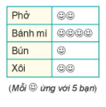

Lập bảng thống kê biểu diễn số lượng học sinh trong lớp yêu thích mỗi món ăn.

Lời giải:

Số lượng học sinh trong lớp yêu thích phở là:

5. 2 = 10 ( học sinh)

Số lượng học sinh trong lớp yêu thích bánh mì là:

5. 4 = 20 ( học sinh)

Số lượng học sinh trong lớp yêu thích bún là:

5. 1 = 5 ( học sinh)

Số lượng học sinh trong lớp yêu thích phở là:

5. 2 = 10 ( học sinh)

Ta có bảng thống kê sau:

| Tên món ăn | Phở | Bánh mì | Bún | Xôi |
| --- | --- | --- | --- | --- |
| Số lượng học sinh | 10 | 20 | 5 | 10 |

**Vận dụng trang 75 Toán lớp 6 Tập 2:**

Một cuộc điều tra về vệ sinh trường học cho thấy có 50 học sinh có sử dụng xà phòng rửa tay, 30 học sinh chỉ rửa tay bằng nước sạch, 10 học sinh không rửa tay trước khi ăn.

a) Lập bảng thống kê biểu diễn dữ liệu đã thu thập;

b) Cho mỗi  ứng với 10 học sinh. Vẽ biểu đồ tranh cho bảng thống kê thu được từ câu a.

Lời giải:

a) Bảng thống kê biểu diễn dữ liệu trên là:

| Dụng cụ rửa tay | Xà phòng | Nước sạch | Không rửa tay |
| --- | --- | --- | --- |
| Số học sinh | 50 | 30 | 10 |

b)

Số học sinh rửa tay có sử dụng xà phòng rửa tay ứng với: 50: 10 = 5 (biểu tượng)

Số học sinh chỉ rửa tay bằng nước sạch ứng với: 30: 10 = 3 (biểu tượng)

Số học sinh không rửa tay trước khi ăn ứng với: 10: 10 = 1 (biểu tượng)

Ta có biểu đồ tranh sau đây:

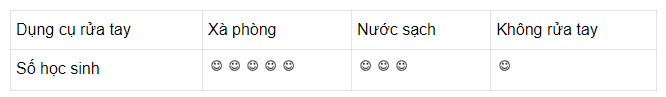

**Bài 9.7 trang 76 Toán lớp 6 Tập 2:**

Một phường lắp đặt hệ thống lấy ý kiến đánh giá của nhân dân về thái độ phục vụ của cán bộ phường.

Biểu đồ tranh dưới đây là kết quả đánh giá của người dân về một cán bộ trong một tuần làm việc ( mỗi biểu tượng thể hiện kết quả một lần đánh giá, hài lòng:  , bình thường:  , không hài lòng:  ).

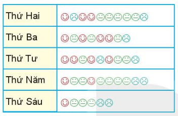

Cả tuần có bao nhiêu lượt người cho ý kiến đánh giá về cán bộ này? Có bao nhiêu lượt đánh giá hài lòng, bình thường, không hài lòng?

Lời giải:

Số lượt đánh giá cán bộ từng ngày trong một tuần làm việc được thống kê ở bảng dưới đây:

| Số lượt đánh giá | Hài lòng | Bình thường | Không hài lòng |
| --- | --- | --- | --- |
| Thứ Hai | 3 | 5 | 2 |
| Thứ Ba | 4 | 3 | 1 |
| Thứ Tư | 4 | 3 | 2 |
| Thứ Năm | 2 | 6 | 2 |
| Thứ Sáu | 1 | 3 | 2 |
| Tổng | 14 | 20 | 9 |

Tổng số lượt đánh giá hài lòng trong tuần là: 3 + 4 + 4 + 2 + 1 = 14 (lần)

Tổng số lượt đánh giá bình thường trong tuần là: 5 + 3 + 3 + 6 + 3 = 20 (lần)

Tổng số lượt đánh giá không hài lòng trong tuần là: 2 + 1 + 2 + 2 + 2 = 9 (lần)

Số lượt người đánh giá về cán bộ này trong cả tuần là: 14 + 20 + 9 = 43 (lượt người)

**Bài 9.8 trang 76 Toán lớp 6 Tập 2:**

Biểu đồ tranh sau đây cho biết số lượt ô tô vào gửi tại một bãi đỗ xe vào các ngày trong một tuần.

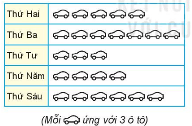

Hãy lập bảng thống kê biểu diễn số ô tô vào gửi tại bãi đỗ xe vào các ngày trong tuần.

Lời giải:

Số ô tô gửi vào bãi đỗ xe vào thứ Hai là:

3. 5 = 15 (ô tô)

Số ô tô gửi vào bãi đỗ xe vào thứ Ba là:

3. 7 = 21 (ô tô)

Số ô tô gửi vào bãi đỗ xe vào thứ Tư là:

3. 3 = 9 (ô tô)

Số ô tô gửi vào bãi đỗ xe vào thứ Năm là:

3. 4 = 12 (ô tô)

Số ô tô gửi vào bãi đỗ xe vào thứ Sáu là:

3. 6 = 18 (ô tô)

Do vậy, ta có bảng thống kê sau:

| Thứ | Hai | Ba | Tư | Năm | Sáu |
| --- | --- | --- | --- | --- | --- |
| Số ô tô gửi bãi đỗ xe | 15 | 21 | 9 | 12 | 18 |

**Bài 9.9 trang 76 Toán lớp 6 Tập 2:**

Lớp 6A lấy ý kiến của các bạn trong lớp về việc tham gia các câu lạc bộ ngoại ngữ với 3 lựa chọn:

A. Tiếng Anh

B. Tiếng Pháp

C. Tiếng Nga

Mỗi học sinh chỉ được chọn tham gia một trong ba câu lạc bộ. Kết quả khảo sát như sau:

A B B C C B A C A A A A B A B A A A B B A

B B B A C A A B A B A A A C C

a) Lập bảng thống kê biểu diễn số lượng học sinh đăng kí tham gia mỗi câu lạc bộ;

b) Vẽ biểu đồ tranh cho bảng thống kê ở câu a.

Lời giải:

a)

+) Có tổng số chữ A qua khảo sát trên là 18 nghĩa là có 18 bạn tham gia câu lạc bộ tiếng Anh

+) Có tổng số chữ B qua khảo sát trên là 12 nghĩa là có 12 bạn tham gia câu lạc bộ tiếng Pháp

+) Có tổng số chữ C qua khảo sát trên là 6 nghĩa là có 6 bạn tham gia câu lạc bộ tiếng Nga

Ta có bảng thống kê sau:

| Câu lạc bộ | Tiếng Anh | Tiếng Pháp | Tiếng Nga |
| --- | --- | --- | --- |
| Số lượng học sinh tham gia | 18 | 12 | 6 |

b) Vì ƯCLN(18, 12, 6) = 6 nên ta sẽ dùng mỗi biểu tượng @ biểu diễn 6 học sinh tham gia câu lạc bộ

Số học sinh tham gia câu lạc bộ tiếng Anh ứng với: 18: 6 = 3 (biểu tượng)

Số học sinh tham gia câu lạc bộ tiếng Pháp ứng với: 12: 6 = 2 (biểu tượng)

Số học sinh tham gia câu lạc bộ tiếng Nga ứng với: 6: 6 = 1 (biểu tượng)

Ta có biểu đồ tranh dưới đây:

| Câu lạc bộ | Tiếng Anh | Tiếng Pháp | Tiếng Nga |
| --- | --- | --- | --- |
| Số lượng học sinh tham gia | @@@ | @@ | @ |

**Bài 9.10 trang 76 Toán lớp 6 Tập 2:**

Bảng thống kê sau cho biết số lượng tin nhắn một người nhận được vào các ngày làm việc trong tuần.

| Ngày | Số tin nhắn |
| --- | --- |
| Thứ hai | 6 |
| Thứ ba | 4 |
| Thứ tư | 4 |
| Thứ Năm | 2 |
| Thứ Sáu | 8 |

Dùng mỗi biểu tượng  ứng với 2 tin nhắn, hãy vẽ biểu đồ tranh biểu diễn bảng thống kê trên.

Lời giải:

Số tin nhắn của một người nhận được vào thứ Hai ứng với: 6: 2 = 3 (biểu tượng)

Số tin nhắn của một người nhận được vào thứ Ba ứng với: 4: 2 = 2 (biểu tượng)

Số tin nhắn của một người nhận được vào thứ Tư ứng với: 4: 2 = 2 (biểu tượng)

Số tin nhắn của một người nhận được vào thứ Năm ứng với: 2: 2 = 1 (biểu tượng)

Số tin nhắn của một người nhận được vào thứ Sáu ứng với: 8: 2 = 4 (biểu tượng)

Ta có biểu đồ tranh dưới đây:

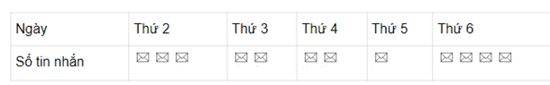

## Bài 40. Biểu đồ cột
**Luyện Tập 1 trang 78 Toán lớp 6 Tập 2:**

(1) Để chuẩn bị cho việc xây dựng tủ sách lớp học, lớp trưởng làm một phiếu hỏi về thể loại văn học dân gian yêu thích của các bạn trong lớp và thu được

Kết quả như Bảng 9.3 (mỗi gạch ứng với một bạn).

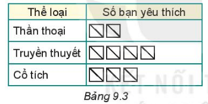

a) Lập bảng thống kê số học sinh yêu thích các thể loại văn học dân gian từ Bảng 9.3;

b) Vẽ biểu đồ Hình 9.7 vào vở rồi hoàn thiện biểu đồ cột biểu diễn bảng thống kê ở câu a.

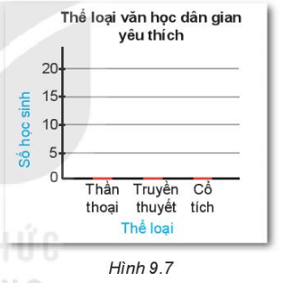

(2) Mai đếm số cánh hoa của một số loài hoa và thống kê theo Bảng 9.4.

Em hãy vẽ biểu đồ cột cho bảng thống kê này.

| Tên loài hoa | Sen | Tulip | Mai | Dã quỳ |
| --- | --- | --- | --- | --- |
| Số cánh hoa | 8 | 6 | 5 | 13 |

Bảng 9.4

Lời giải:

(1)

a) Cột số bạn yêu thích thể loại thần thoại có 10 gạch nên có 10 bạn yêu thích thể loại thần thoại.

+) Cột số bạn yêu thích thể loại truyền thuyết nên có 20 bạn yêu thích thể loại truyền thuyết

+) Cột số bạn yêu thích thể loại cổ tích nên có 15 bạn yêu thích thể loại cổ tích.

Ta có bảng thống kê sau:

| Thể loại | Thần thoại | Truyền thuyết | Cổ tích |
| --- | --- | --- | --- |
| Số bạn yêu thích | 10 | 20 | 15 |

b)

Với mỗi thể loại văn học trên trục ngang, ta vẽ một hình chữ nhật có chiều cao bằng số bạn yêu thích thể loại văn học (chiều rộng là đoạn thẳng màu đỏ) có sẵn trên hình vẽ

Ta được biểu đồ cột như sau:

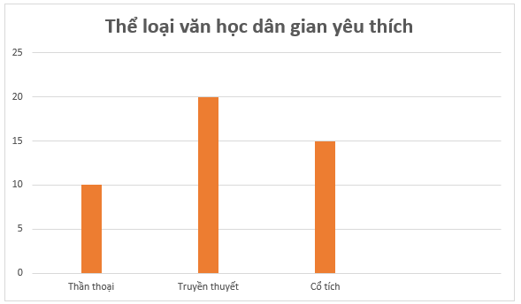

(2)

Bước 1: Vẽ trục ngang biểu diễn tên các loài hoa. Vẽ trục đứng biểu diễn số cánh hoa

Bước 2: Với mỗi loài hoa trên trục ngang, ta vẽ một hình chữ nhật có chiều cao bằng số cánh hoa của loài hoa (chiều rộng của các hình chữ nhật bằng nhau)

Bước 3: Đặt tên cho biểu đồ, tô màu xanh cho các cột để hoàn thiện biểu đồ ta được:

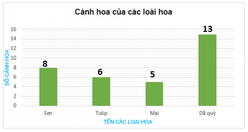

**Luyện Tập 2 trang 79, 80 Toán lớp 6 Tập 2:**

(1) Biểu đồ cột ở Hình 9.9 cho biết tốc độ tốc độ tối đa của một số loài động vật (đơn vị là dặm/giờ; dặm (mile) là một đơn vị đo độ dài; 1 dặm = 1,609 km).

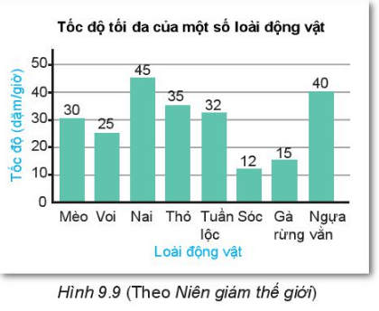

a) Trong các nhận xét dưới đây, nhận xét nào phù hợp với thông tin từ biểu đồ (H.9.9)? Vì sao?

b) Trong biểu đồ trên, em thấy những loài động vật nào có tốc độ tối đa từ 10 đến 19, từ 40 đến 49 (dặm/giờ)?

(2) Cho biểu đồ cột Hình 9.10.

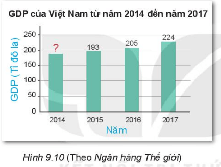

a) Thay dấu "?" trong biểu đồ trên bằng số liệu thích hợp nếu biết GDP của Việt Nam năm 2014 là 186 tỉ đô la;

b) Từ năm 2014 đến năm 2017, GDP của Việt Nam có xu hướng tăng hay giảm?

Lời giải:

(1)

a) Quan sát biểu đồ ta có:

+ Cột biểu diễn tốc độ của Nai là cao nhất là 45 dặm/giờ nên Nai chạy nhanh nhất do đó bạn Vuông nói đúng và bạn Pi sai.

+ Tốc độ tối đa của sóc là 12 (dặm/giờ)

Hai lần tốc độ tối đa của sóc bằng: 2. 12 = 24 (dặm/giờ)

Tốc độ tối đa của thỏ là 35 (dặm/ giờ)

Vì 24 khác 35 nên hai lần tốc độ tối đa của sóc không bằng tốc độ tối đa của thỏ.

Do đó tốc độ tối đa của thỏ gấp khoảng 2 lần tốc độ tối đa của sóc là sai nên bạn Tròn nói sai.

Vậy nhận xét của bạn Vuông là phù hợp, nhận xét của bạn Pi và bạn Tròn là không phù hợp.

b) Từ biểu đồ cột ở hình 9.9, ta có:

Loài có tốc độ tối đa từ 10 đến 19 dặm/giờ là: Sóc (12 dặm/giờ); Gà rừng (15 dặm/ giờ)

Loài có tốc độ tối đa từ 40 đến 49 dặm/giờ là: Ngựa vằn (40 dặm/ giờ); Nai (45 dặm/ giờ)

(2)

a) Vì GDP của Việt Nam năm 2014 là 186 tỉ đô la nên thay dấu “?” bằng số 186.

Khi đó ta có biểu đồ:

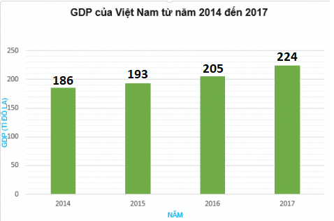

b) Vì 186 < 193 < 205 < 224 nên GDP của Việt Nam có xu hướng tăng từ năm 2014 đến năm 2017.

**Thử thách nhỏ trang 80 Toán lớp 6 Tập 2:**

Bảng 9.5 cho biết lợi nhuận của một cửa hàng trong quý I năm 2020.

| Tháng | 1 | 2 | 3 |
| --- | --- | --- | --- |
| Lợi nhuận ( triệu đồng) | -10 | -8 | 5 |

Bảng 9.5

Minh vẽ biểu đồ cột để biểu diễn bảng thống kê này như Hình 9.11. Theo em, biểu đồ Minh vẽ có hợp lí không? Các cột nằm dưới trục ngang thể hiện điều gì?

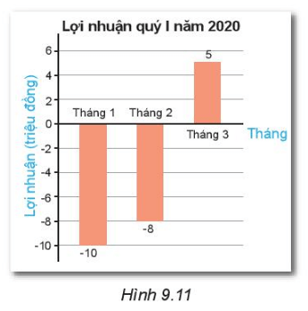

Lời giải:

Theo em, biểu đồ mà Minh vẽ hợp lí vì có đầy đủ các thông tin số liệu lợi nhuận (triệu đồng) trên bản đồ. Các cột nằm dưới trục ngang biểu diễn số âm thể hiện số tiền bị lỗ trong tháng của cửa hàng.

**Bài 9.11 trang 81 Toán lớp 6 Tập 2:**

Ngày nào trong tuần An dành thời gian tự học ở nhà nhiều nhất?

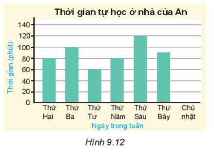

Lời giải:

Từ biểu đồ Hình 9.12, ta thấy cột thứ sáu cao nhất nên thứ sáu An dành thời gian tự học ở nhà nhiều nhất là 120 phút.

**Bài 9.12 trang 81 Toán lớp 6 Tập 2:**

Ngày nào trong tuần An không tự học ở nhà?

Lời giải:

Từ biểu đồ hình 9.12 ta thấy chủ nhật cột biểu đồ thấp nhất là 0 nên chủ nhật An không tự học ở nhà.

**Bài 9.13 trang 81 Toán lớp 6 Tập 2:**

Tổng thời gian trong tuần An tự học ở nhà là bao nhiêu phút?

Lời giải:

Từ biểu đồ hình 9.12 ta thấy:

Thời gian An tự học ở nhà từ thứ hai đến chủ nhật lần lượt là: 80 phút, 100 phút, 60 phút, 80 phút, 120 phút, 90 phút, 0 phút

Tổng số thời gian trong tuần An tự học ở nhà là:

80 + 100 + 60 + 80 + 120 + 90 + 0 = 530 (phút)

Vậy tổng thời gian trong tuần An tự học 530 phút.

**Bài 9.14 trang 81 Toán lớp 6 Tập 2:**

Hoàn thiện biểu đồ nếu ngày Chủ nhật An dành 50 phút tự học ở nhà.

Lời giải:

Nếu ngày chủ nhật An dành 50 phút tự học ở nhà nên ta có biểu đồ là:

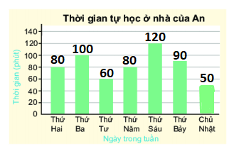

**Bài 9.15 trang 81 Toán lớp 6 Tập 2:**

Lập bảng thống kê thời gian tự học ở nhà của An vào các ngày trong tuần.

Lời giải:

Ta có bảng thống kê sau:

| Ngày trong tuần | Thứ 2 | Thứ 3 | Thứ 4 | Thứ 5 | Thứ 6 | Thứ 7 | Chủ nhật |
| --- | --- | --- | --- | --- | --- | --- | --- |
| Thời gian (phút) | 80 | 100 | 60 | 80 | 120 | 90 | 0 |

**Bài 9.16 trang 81 Toán lớp 6 Tập 2:**

Bảng sau cho biết số lượng các bạn lớp Khoa hâm mộ ba câu lạc bộ bóng đá ở giải Ngoại hạng Anh (mỗi gạch ứng với một bạn).

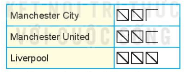

Lập bảng thống kê và vẽ biểu đồ cột biểu diễn bảng thống kê đó.

Lời giải:

+) Ở cột Manchester City có 12 gạch nên có 12 bạn hâm mộ

+) Ở cột Manchester United có 13 gạch nên có 13 bạn hâm mộ

+) Ở cột Liverpool có 15 gạch nên có 15 bạn hâm mộ

Ta có bảng thống kê sau:

| Câu lạc bộ bóng đá | Manchester City | Manchester United | Liverpool |
| --- | --- | --- | --- |
| Số lượng các bạn hâm mộ | 12 | 13 | 15 |

Các bước vẽ biểu đồ cột là:

Bước 1: Vẽ trục ngang biểu diễn tên các câu lạc bộ. Vẽ trục đứng biểu diễn số học sinh hâm mộ

Bước 2: Với mỗi câu lạc bộ trên trục ngang, ta vẽ một hình chữ nhật có chiều cao bằng số học sinh hâm mộ của mỗi câu lạc bộ (chiều rộng của các hình chữ nhật bằng nhau)

Bước 3: Đặt tên cho biểu đồ là số lượng các bạn hâm mộ câu lạc bộ bóng đá lớp Khoa, tô màu xanh cho các cột để hoàn thiện biểu đồ ta được:

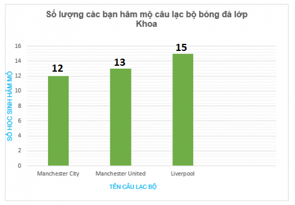

**Bài 9.17 trang 81 Toán lớp 6 Tập 2:**

Cho bảng thống kê sau:

| Thể loại phim | Hành động | Khoa học viễn tưởng | Hoạt hình | Hài |
| --- | --- | --- | --- | --- |
| Số lượng bạn yêu thích | 6 | 5 | 12 | 8 |

Hãy vẽ biểu đồ cột biểu diễn bảng thống kê trên.

Lời giải:

Các bước vẽ biểu đồ cột là:

Bước 1: Vẽ trục ngang biểu diễn thể loại phim yêu thích. Vẽ trục đứng biểu diễn số lượng học sinh yêu thích

Bước 2: Với mỗi thể loại trên trục ngang, ta vẽ một hình chữ nhật có chiều cao bằng số học sinh yêu thích của mỗi thể loại phim (chiều rộng của các hình chữ nhật bằng nhau)

Bước 3: Đặt tên cho biểu đồ là thể loại phim yêu thích, tô màu xanh cho các cột để hoàn thiện biểu đồ ta được:

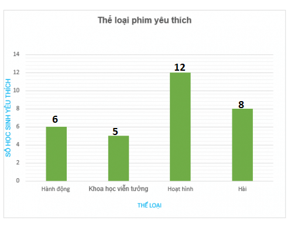

## Bài 41. Biểu đồ cột kép
**Luyện Tập 1 trang 83 Toán lớp 6 Tập 2:**

Bảng thống kê 9.7 cho biết số bé trai và bé gái được sinh ra trong ba ngày đầu năm 2020 tại một bệnh viện địa phương.

| | Ngày 1 | Ngày 2 | Ngày 3 |
| --- | --- | --- | --- |
| Bé trai | 9 | 6 | 7 |
| Bé gái | 5 | 6 | 4 |

Từ Bảng 9.7, em hãy thay các dấu "?" trong Hình 9.18 bằng số liệu phù hợp.

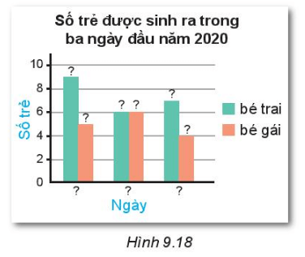

Lời giải:

Từ bảng thống kê trên ta thấy:

+) Số bé trai được sinh ra trong ba ngày 1; 2; 3 lần lượt là 9, 6, 7 bé (được thể hiện ở cột màu xanh)

+) Số bé gái được sinh ra trong ba ngày 1; 2; 3 lần lượt là 5, 6, 4 bé (được thể hiện ở cột màu hồng)

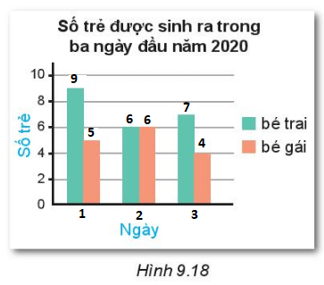

**Luyện Tập 2 trang 84, 85 Toán lớp 6 Tập 2:**

(1) Biểu đồ Hình 9.20 cho biết lượng mưa trung bình các tháng trong năm 2018 tại hai trạm Tuyên Quang và Nha Trang.

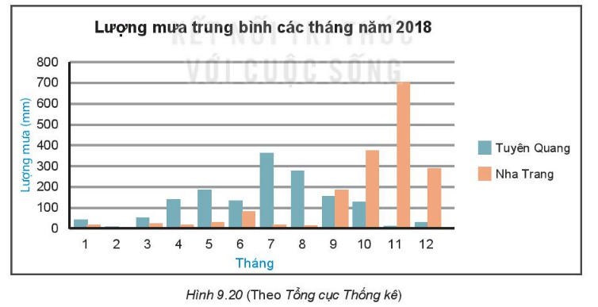

a) Quan sát biểu đồ và cho biết cột màu nào biểu diễn lượng mưa trung bình các tháng năm 2018 tại hai trạm Tuyên Quang và Nha Trang;

b) Kể tên ba tháng có lượng mưa lớn nhất ở mỗi trạm. Từ đó dự đoán thời gian mùa mưa ở các địa phương này.

(2) Quan sát biểu đồ Hình 9.21 và trả lời câu hỏi:

a) Nước nào có chiều cao trung bình của nam cao nhất, thấp nhất?

b) Nước nào có chiều cao trung bình của nữ cao nhất, thấp nhất?

c) Sự chênh lệch chiều cao giữa nam và nữ ở nước nào lớn nhất?

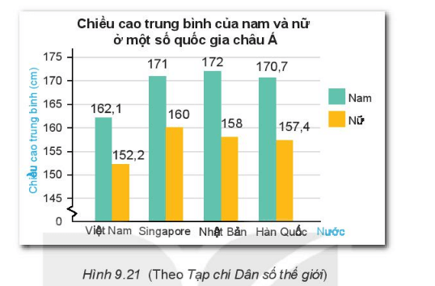

Lời giải:

1.

a) Cột màu xanh và màu cam lần lượt biểu diễn lượng mưa trung bình của các tháng năm 2018 ở Tuyên Quang và Nha Trang.

b)

+) 3 cột biểu đồ cao nhất thể hiện lượng mưa ở Tuyên Quang là: tháng 5, tháng 7, tháng 8 nên ba tháng có lượng mưa lớn nhất ở trạm Tuyên Quang là : tháng 5, tháng 7, tháng 8.

Thời gian mùa mưa ở Tuyên quang vào mùa các tháng 5, 7, 8.

+) 3 cột biểu đồ cao nhất thể hiện lượng mưa ở Nha Trang là: tháng 10, tháng 11, tháng 12 nên ba ba tháng có lượng mưa lớn nhất ở trạm Nha Trang là : tháng 10 , tháng 11 , tháng 12.

Thời gian mùa mưa của Nha Trang là 10 , 11 , 12.

2.

a) Nhìn vào cột màu xanh thể hiện chiều cao trung bình của nam ở một số quốc gia châu Á, vì 162, 5 < 170, 7 < 171 < 172 nước có chiều cao trung bình của nam cao nhất là: Nhật Bản

Nước có chiều cao trung bình của nam thấp nhất là : Việt Nam

b) Nhìn vào cột màu xanh thể hiện chiều cao trung bình của nữ ở một số quốc gia châu Á, vì 152,2 < 157,4 < 158 < 160 nên nước có chiều cao trung bình của nữ cao nhất là: Singapore

Nước có chiều cao trung bình của nữ thấp nhất là : Việt Nam

c) Việt Nam có sự chênh lệch chiều cao trung bình giữa nam và nữ là:

162,1 – 152,2 = 9,9 (cm)

Singapore có sự chênh lệch chiều cao trung bình giữa nam và nữ là:

171 – 160 = 11 (cm)

Nhật Bản có sự chênh lệch chiều cao trung bình giữa nam và nữ là:

172 – 158 = 14 (cm)

Hàn Quốc có sự chênh lệch chiều cao trung bình giữa nam và nữ là:

170,7 – 157, 4 = 13, 3 (cm)

Vì 9,9 < 11 < 13,3 < 14 nên nước có sự chênh lệch chiều cao giữa nam và nữ lớn nhất là Nhật Bản.

**Bài 9.18 trang 86 Toán lớp 6 Tập 2:**

Liệt kê ba tháng cửa hàng bán được nhiều quạt trần nhất.

Biểu đồ Hình 9.23 cho biết số lượng quạt trần và quạt cây bán được tại một cửa hàng điện máy trong năm 2018.

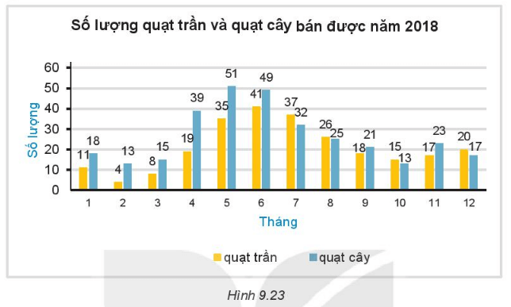

Lời giải:

Để tìm ra ba tháng cửa hàng bán được nhiều quạt trần nhất ta chú ý đến các cột màu vàng

Ta thấy cột biểu đồ ở các tháng 5, 6, 7 cao nhất biểu đồ nên ba tháng cửa hàng bán được nhiều quạt trần nhất là: 5, 6, 7 với số lượng quạt trần tương ứng là 35; 41; 37.

**Bài 9.19 trang 86 Toán lớp 6 Tập 2:**

Liệt kê ba tháng cửa hàng bán được nhiều quạt cây nhất.

Biểu đồ Hình 9.23 cho biết số lượng quạt trần và quạt cây bán được tại một cửa hàng điện máy trong năm 2018.

Lời giải:

Để tìm ra ba tháng cửa hàng bán được nhiều quạt cây nhất ta chú ý đến các cột biểu đồ màu xanh.

Ta thấy cột biểu đồ ở các tháng 4, 5, 6 cao nhất biểu đồ nên ba tháng cửa hàng bán được nhiều quạt trần nhất là: 4, 5, 6, với số máy bán được tương ứng là 39, 51, 49.

**Bài 9.20 trang 86 Toán lớp 6 Tập 2:**

Tính tổng số lượng quạt cả hai loại bán được trong ba tháng 5, 6, 7 và ba tháng 10, 11, 12 rồi so sánh.

Biểu đồ Hình 9.23 cho biết số lượng quạt trần và quạt cây bán được tại một cửa hàng điện máy trong năm 2018.

Lời giải:

Tổng số lượng quạt cả hai loại bán được trong 3 tháng 5,6,7 là:

35 + 51 + 41+ 49 + 37 + 32 = 245 (chiếc)

Tổng số lượng quạt cả hai loại bán được trong 3 tháng 10,11,12 là:

15 + 13 + 17 + 23 + 20 + 17 = 105 (chiếc )

Vì 105 < 245 nên tổng số lượng quạt cả hai loại bán được trong 3 tháng 10,11,12 ít hơn tổng số lượng quạt cả hai loại bán được trong 3 tháng 5,6,7.

**Bài 9.21 trang 86 Toán lớp 6 Tập 2:**

Các loại quạt có xu hướng bán chạy hơn vào mùa nào trong năm?

Biểu đồ Hình 9.23 cho biết số lượng quạt trần và quạt cây bán được tại một cửa hàng điện máy trong năm 2018.

Lời giải:

Từ biểu đồ cột trên ta nhận thấy, cột ở tháng 5, 6, 7 cao nhất nên các loại quạt có xu hướng bán chạy hơn vào các tháng 5, 6, 7 trong năm.

**Bài 9.22 trang 86 Toán lớp 6 Tập 2:**

Từ biểu đồ, không thực hiện tính toán, hãy cho biết loại quạt nào bán được với số lượng nhiều hơn tại cửa hàng điện máy.

Biểu đồ Hình 9.23 cho biết số lượng quạt trần và quạt cây bán được tại một cửa hàng điện máy trong năm 2018.

Lời giải:

Từ biểu đồ cột trên ta nhận thấy ở hầu hết các tháng thì biểu đồ cột màu xanh cao hơn biểu đồ cột màu vàng nên loại quạt bán được với số lượng nhiều hơn tại cửa hàng điện máy là: quạt cây.

**Bài 9.23 trang 86 Toán lớp 6 Tập 2:**

Vẽ biểu đồ cột kép biểu diễn bảng thống kê số lượng học sinh đạt điểm giỏi môn Ngữ văn và Toán của các lớp khối 6.

| | 6A | 6B | 6C | 6D |
| --- | --- | --- | --- | --- |
| Ngữ Văn | 9 | 11 | 16 | 12 |
| Toán | 8 | 7 | 12 | 15 |

Lời giải:

Để vẽ biểu đồ cột kép biểu diễn bảng thống kê ở trên, em thực hiện theo các bước sau:

Bước 1: Vẽ các trục biểu diễn số lượng học sinh và các lớp 6.

Bước 2: Với mỗi lớp 6, vẽ hai hình chữ nhật cạnh nhau với chiều rộng bằng nhau và chiều cao bằng số lượng học sinh giỏi mỗi môn Văn và Toán

Bước 3: Tô màu xanh lam cho cột học sinh giỏi Văn mỗi lớp, màu cam cho cột học sinh giỏi Toán mỗi lớp và ghi chú thích. Đặt tên cho biểu đồ là số lượng học sinh đạt điểm giỏi môn Văn và Toán của các lớp khối 6 để hoàn thiện biểu đồ dưới đây:

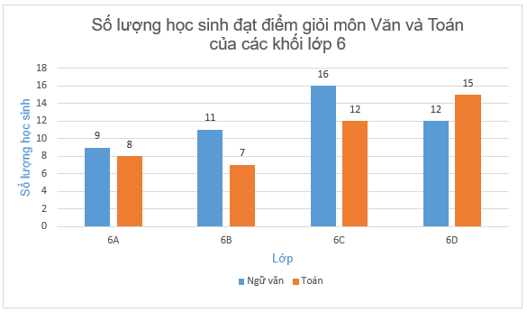

**Bài 9.24 trang 86 Toán lớp 6 Tập 2:**

Bảng thống kê sau đây cho biết số lượng các bạn nam, nữ trong lớp yêu thích một số môn thể thao.

| | Bóng đá | Cầu lông | Cờ vua | Bón bàn |
| --- | --- | --- | --- | --- |
| Nam | 20 | 15 | 10 | 17 |
| Nữ | 5 | 6 | 12 | 9 |

Từ bảng trên, em hãy thay dấu "?" bằng dữ liệu thích hợp để hoàn thiện biểu đồ ở Hình 9.24.

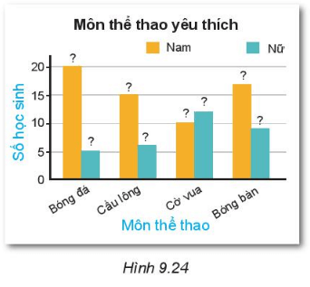

Lời giải:

Ở bảng thống kê và hình 9.24 số lượng học sinh nam yêu thích môn bóng đá, cầu lông, cờ vua và bóng bàn lần lượt là 20; 15; 10; 17 (ở cột màu cam)

+) số lượng học sinh nữ yêu thích môn bóng đá, cầu lông, cờ vua và bóng bàn lần lượt là 5; 6; 12; 9 (ở cột màu xanh)

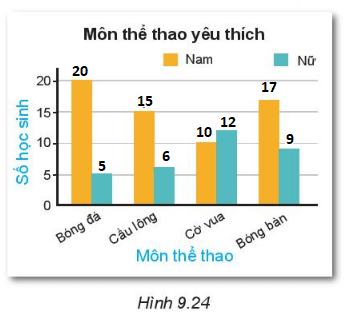

## Luyện tập chung trang 87
**Thực hành trang 87, 88 Toán lớp 6 Tập 2:**

Em đã tưởng tượng gì về công việc của mình trong tương lai?

Em có muốn biết ước mơ về công việc trong tương lai của các bạn trong lớp không?

Hãy cùng các bạn chia sẻ những ước mơ đó nhé!

Đầu tiên, hãy chia lớp thành các nhóm. Mỗi nhóm sẽ thực hiện điều tra độc lập và chia sẻ lại dữ liệu của nhóm mình với các nhóm khác sau khi hoàn thành.

Bước 1. THU THẬP DỮ LIỆU

(1) Mỗi nhóm lập phiếu hỏi (theo mẫu phiếu như hình bên).

Em có thể lựa chọn một danh sách công việc khác để phù hợp với các bạn trong lớp mình.

(2) Phát phiếu hỏi cho các bạn trong nhóm để thu thập dữ liệu.

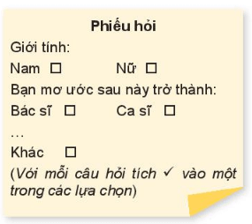

Bước 2. LẬP BẢNG THỐNG KÊ

Thu phiếu hỏi trong nhóm và tổng hợp dữ liệu theo mẫu như bảng bên (mỗi gạch ứng với một bạn).

Tổng hợp dữ liệu của các nhóm thành dữ liệu chung của cả lớp.

Lập bảng thống kê biểu diễn số lượng nam, nữ yêu thích các nghề nghiệp.

| Nghề nghiệp | Nam | Nữ |
| --- | --- | --- |
| Bác sĩ | // | / |
| Ca sĩ | | |
| … | | |
| Khác | | |

Bước 3. VẼ BIỂU ĐỒ

- Vẽ biểu đồ cột theo mẫu như Hình 9.25a biểu diễn số học sinh theo lựa chọn nghề nghiệp.

- Vẽ biểu đồ cột kép theo mẫu Hình 9.2Bb biểu diễn số học sinh nam, nữ theo lựa chọn nghề nghiệp.

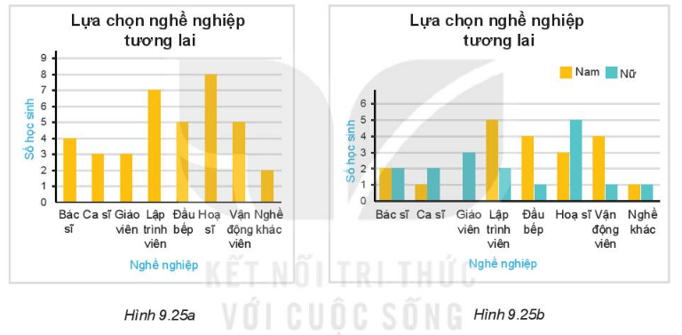

Bước 4. PHÂN TÍCH DỮ LIỆU :

Trả lời các câu hỏi sau dựa trên dữ liệu và các biểu đồ thu được.

1. Công việc nào được nhiều bạn lựa chọn nhất? Nhiều bạn nam lựa chọn nhất? Nhiều bạn nữ lựa chọn nhât?

2. Các bạn nam có xu hướng chọn những công việc nào?

3. Các bạn nữ có xu hướng chọn những công việc nào?

Lời giải:

Thực hành với mỗi lớp học của các em.

Dưới đây là một bài mẫu của một lớp 6 có 40 học sinh gồm 25 nam, 15 nữ chia thành 4 nhóm, mỗi nhóm có 10 học sinh.

*Bước 1:* Phát phiếu hỏi cho các bạn trong nhóm tờ phiếu dưới đây:

Giới tính:

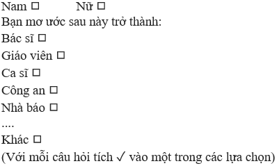

*Bước 2:* Lập bảng thống kê

Thu lại phiếu hỏi 4 nhóm và tổng hợp dữ liệu cả lớp ta được:

| Nghề nghiệp | Nam | Nữ |
| --- | --- | --- |
| Bác sĩ | / / / / / / / / / / / / | / |
| Giáo viên | / / | / / / / / / / / / / |
| Ca sĩ | / | / |
| Công an | / / / / / / / | / |
| Nhà báo | | / |
| .... | | |
| Khác | /// | / |

Bảng thống kê biểu diễn số lượng nam, nữ lựa chọn các nghề nghiệp trong tương lai:

| Số bạn | Bác sĩ | Giáo viên | Ca sĩ | Công an | Nhà báo | Khác |
| --- | --- | --- | --- | --- | --- | --- |
| Nam | 12 | 2 | 1 | 7 | 0 | 3 |
| Nữ | 1 | 10 | 1 | 1 | 1 | 1 |
| Tổng số học sinh | 13 | 12 | 2 | 8 | 1 | 4 |

*Bước 3:* Vẽ biểu đồ

*Biểu đồ 1:* Biểu diễn số học sinh theo lựa chọn nghề nghiệp

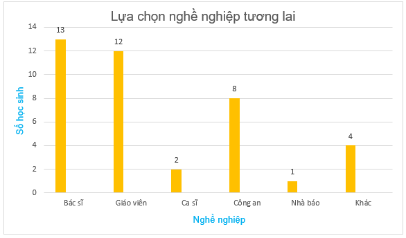

*Biểu đồ 2:* Biểu diễn số học sinh nam, nữ theo lựa chọn nghề nghiệp.

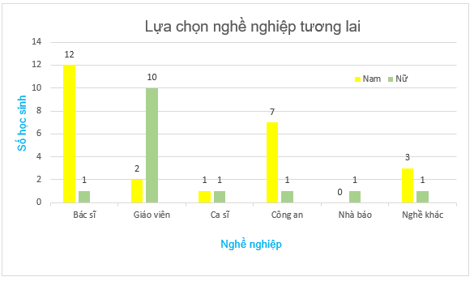

*Bước 4:* Phân tích dữ liệu

1. Ở biểu đồ 1, ta thấy cột bác sĩ cao nhất với số lượng 13 nên công việc được nhiều bạn lựa chọn nhất là bác sĩ.

Ở biểu đồ 2, ta thấy ở cột màu vàng thể hiện số học sinh nam, cột bác sĩ vẫn cao nhất với số lượng 12 nên công việc được nhiều bạn nam lựa chọn nhất là bác sĩ; còn ở cột màu xanh thể hiện số học sinh nữ, cột giáo viên cao nhất với số lượng 10 nên công việc được nhiều bạn nữ lựa chọn nhất là giáo viên.

2. Do sự phân tích ở ý 2 nên các bạn nam có xu hướng lựa chọn nghề nghiệp bác sĩ còn các bạn nữ có xu hướng lựa chọn nghề giáo viên.

## Bài 42. Kết quả có thể và sự kiện trong trò chơi, thí nghiệm
**Luyện Tập 1 trang 91 Toán lớp 6 Tập 2:**

Chiếc nón kì diệu từng là một trò chơi truyền hình nổi tiếng ở Việt Nam .

Quan sát Hình 9.27 và liệt kê tất cả các kết quả có thể khi quay chiếc nón kì diệu.

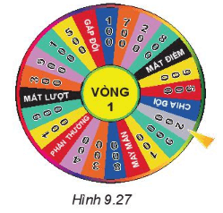

Lời giải:

Kết quả có thể nhận được khi quay là: mất lượt ; mất điểm ; phần thưởng ; may mắn ; chia đôi; gấp đôi; 100 ; 200 ; 300 ; 400 ; 500 ; 600 ; 700 ; 800 ; 900 .

**Luyện Tập 2 trang 92 Toán lớp 6 Tập 2:**

Minh quay tấm bìa và thấy mũi tên chỉ vào ô số 3 như hình bên.

Hãy cho biết sự kiện nào sau đây xảy ra:

(1) Mũi tên chỉ vào ô ghi số 3 hoặc 5.

(2) Mũi tên chỉ vào ô ghi số 4:

(3) Mũi tên chỉ vào ô ghi số lớn hơn 5.

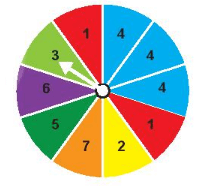

Lời giải:

Vì mũi tên chỉ vào ô ghi số 3 nên:

(1). Sự kiện xảy ra

(2). Sự kiện không xảy ra

(3). Sự kiện không xảy ra

**Thử thách nhỏ trang 92 Toán lớp 6 Tập 2:**

Một hộp kín đựng 5 viên bi xanh, 3 viên bi đỏ và 2 viên bi vàng có cùng kích thước. Mỗi lượt chơi, Minh và Khoa lần lượt lấy ra một viên bi từ hộp. Quan sát và ghi lại màu của viên bi rồi trả lại viên bi vào hộp.

Màu của các viên bi trong mỗi lượt lấy được Minh và Khoa ghi lại như hình bên (X: xanh, Ð: đỏ, V: vàng).

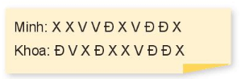

Người thắng là người lấy được nhiều viên bi đỏ hơn sau 10 lượt chơi. Sự kiện Minh thắng có xảy ra không?

Lời giải:

Minh lấy được 3 viên bi đỏ trong khi Khoa lấy được 4 viên bi đỏ

Mà 3 < 4 nên sự kiện “Minh thắng” không xảy ra.

**Bài 9.25 trang 93 Toán lớp 6 Tập 2:**

Gieo một con xúc xắc.

a) Liệt kê các kết quả có thể để sự kiện số chấm xuất hiện là số nguyên tố xảy ra;

b) Nếu số chấm xuất hiện là 5 thì sự kiện số chấm xuất hiện không phải là 6 có xảy ra hay không?

Lời giải:

a. Khi gieo con xúc xắc số, các kết quả số chấm xuất hiện có thể là: 1; 2; 3; 4; 5; 6 chấm

Vậy các kết quả có thể để sự kiện số chấm xuất hiện là số nguyên tố xảy ra là:

2, 3, 5 chấm

b. Do 5 khác 6 nên nếu số chấm xuất hiện là 5 thì sự kiện số chấm xuất hiện không phải là 6 có xảy ra.

**Bài 9.26 trang 93 Toán lớp 6 Tập 2:**

Quay tấm bìa như hình sau và xem mũi tên chỉ vào ô nào khi tấm bìa dừng lại.

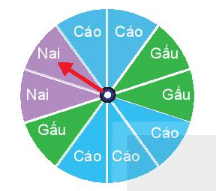

a) Liệt kê các kết quả có thể của thí nghiệm này;

b) Liệt kê các kết quả có thể để sự kiện Mũi tên không chỉ vào ô Nai xảy ra;

c) Nếu mũi tên chỉ vào ô Nai như hình vẽ thì sự kiện Mũi tên chỉ vào ô Gấu hoặc Nai có xảy ra không?

Lời giải:

a. Các kết quả có thể của thí nghiệm này là: Nai; Cáo; Gấu.

b. Các kết quả có thể để sự kiện Mũi tên không chỉ vào ô Nai xảy ra là: Cáo; Gấu

c. Nếu mũi tên chỉ vào ô Nai như hình vẽ thì sự kiện Mũi tên chỉ vào ô Gấu hoặc Nai có xảy ra vì khi quay tấm bìa trên mũi tên giữ nguyên nhưng các ô thay đổi nên các ô Cáo, Gấu sẽ đến cái mũi tên chỉ.

**Bài 9.27 trang 93 Toán lớp 6 Tập 2:**

Trò chơi dành cho hai người chơi. Mỗi người chơi chọn một trong sáu số 1, 2, 3, 4, 5, 6 rồi gieo con xúc xắc năm lần liên tiếp

Mỗi lần gieo, nếu xuất hiện mặt có số chấm bằng số đã chọn thì được 10 điểm, ngược lại bì trừ 5 điểm. Ai được nhiều điểm hơn sẽ thắng.

An và Bình cùng chơi. An chọn số 3 và Bình chọn số 4. Kết quả gieo của An và Bình lần lượt là 2, 3, 6, 4, 3 và 4, 3, 4, 5, 4. Hỏi An hay Bình là người thắng?

Lời giải:

Ta có bảng thống kê các kết quả gieo của An mỗi lần gieo bị trừ 5 điểm hay cộng 10 điểm:

| Lần | Lần 1 | Lần 2 | Lần 3 | Lần 4 | Lần 5 |
| --- | --- | --- | --- | --- | --- |
| Kết quả | 2 khác 3 | 3 = 3 | 6 khác 3 | 4 khác 3 | 3 = 3 |
| Kết quả | Trừ 5 | Cộng 10 | Trừ 5 | Trừ 5 | Cộng 10 |

Do đó số điểm của An là:

-5 + 10 - 5 - 5 + 10 = 5 (điểm)

Ta có bảng thống kê các kết quả gieo của Bình mỗi lần gieo bị trừ hay cộng:

| Lần | Lần 1 | Lần 2 | Lần 3 | Lần 4 | Lần 5 |
| --- | --- | --- | --- | --- | --- |
| Kết quả | 4 = 4 | 3 khác 4 | 4 = 4 | 5 khác 4 | 4 = 4 |
| Kết quả | Cộng 10 | Trừ 5 | Cộng 10 | Trừ 5 | Cộng 10 |

Do đó số điểm của An là:

10 – 5 + 10 - 5 + 10 = 20 (điểm)

Vì 20 > 5 nên số điểm của Bình nhiều hơn của An

Vậy Bình thắng.

**Bài 9.28 trang 93 Toán lớp 6 Tập 2:**

Mai và Linh cùng chơi, mỗi người gieo một đồng xu liên tiếp 30 lần được kết quả như sau ( S: sấp; N: ngửa)

Mai: S N N S S N S N S N S N N S S N N S S N N N S S S N N N S S .

Linh: N S S N N S N S N S S S S N S N N S S S N N N S S S N N S S.

Người chơi được một điểm khi có đúng ba lần liên tiếp đồng xu ra mặt ngửa. người nào được nhiều điểm hơn là người thắng.

Sự kiện Mai thắng có xảy ra hay không?

Lời giải:

+) Ở kết quả gieo đồng xu của Mai:

Số lần gieo có được kết quả 3 lần liên tiếp đều là mặt ngửa là 2 là:

Mai: S N N S S N S N S N S N N S S N N S S N N N S S S N N N S S .

Do đó Mai được 2 điểm.

+) Ở kết quả gieo đồng xu của Linh:

Số lần gieo có được kết quả 3 lần liên tiếp đều là mặt ngửa là 1 là:

Linh: N S S N N S N S N S S S S N S N N S S S N N N S S S N N S S

Do đó Mai được 1 điểm.

Vì 2 > 1 nên Mai đã thắng Linh.

Vậy sự kiện Mai thắng có xảy ra.

## Bài 43. Xác suất thực nghiệm
**Luyện Tập trang 95 Toán lớp 6 Tập 2:**

An gieo hai con xúc xắc cùng lúc 80 lần. Ở mỗi lần gieo, An cộng số chấm xuất hiện ở hai xúc xắc và ghi lại kết quả như bảng sau:

| Tổng số chấm | 2 | 3 | 4 | 5 | 6 | 7 | 8 | 9 | 10 | 11 | 12 |
| --- | --- | --- | --- | --- | --- | --- | --- | --- | --- | --- | --- |
| Số lần | 2 | 5 | 6 | 8 | 11 | 14 | 12 | 9 | 6 | 4 | 3 |

Nếu tổng số chấm xuất hiện ở hai con xúc xắc lớn hơn 6 thì An thắng. Tính xác suất thực nghiệm của sự kiện An thắng.

Lời giải:

Tổng số lần gieo xúc xắc là: n = 80 (lần)

Vì tổng số chấm xuất hiện ở hai con xúc xắc lớn hơn 6 thì An thắng nên số lần An thắng (số lần xuất hiện ở hai con xúc xắc có từ 7 chấm đến 12 chấm) là:

k = 14 + 12 + 9 + 6 + 4 + 3 = 48 (lần)

Xác suất thực nghiệm của sự kiện An thắng là:

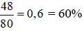

Vậy xác suất thực nghiệm An thắng là 60%

**Bài 9.29 trang 96 Toán lớp 6 Tập 2:**

Minh gieo một con xúc xắc 100 lần và ghi lại số chấm xuất hiện ở mỗi lần gieo được kết quả như sau:

| Số chấm xuất hiện | 1 | 2 | 3 | 4 | 5 | 6 |
| --- | --- | --- | --- | --- | --- | --- |
| Số lần | 15 | 20 | 18 | 22 | 10 | 15 |

Tính xác suất thực nghiệm của các sự kiện sau:

a) Số chấm xuất hiện là số chẵn;

b) Số chấm xuất hiện lớn hơn 2.

Lời giải:

a) Số chấm xuất hiện là số chẵn là số lần xuất hiện số chấm 2, 4 và 6

20 + 22 + 15 = 57

Xác suất thực nghiệm của sự kiện số chấm xuất hiện là số chẵn là:

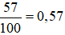

b) Số chấm xuất hiện lớn hơn 2 là số lần xuất hiện số chấm 3, 4, 5, 6

18 + 22 + 10 + 15 = 65

Xác suất thực nghiệm của sự kiện số chấm xuất hiện lớn hơn 2 là:

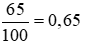

Vậy xác suất thực nghiệm của sự kiện số chấm xuất hiện là số chẵn; số chấm xuất hiện lớn hơn 2 lần lượt là 0,57 và 0,65.

**Bài 9.30 trang 96 Toán lớp 6 Tập 2:**

An quay tấm bìa như Hình 9.30 một số lần và ghi kết quả dưới dạng bảng như sau:

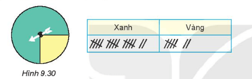

a) An đã quay tấm bìa bao nhiêu lần?

b) Có bao nhiêu lần mũi tên chỉ vào ô màu xanh, bao nhiêu lần mũi tên chỉ vào ô màu vàng?

c) Tính xác suất thực nghiệm của sự kiện Mũi tên chỉ vào ô màu xanh.

Lời giải:

a) Mỗi lần quay tương ứng với 1 gạch, ta đếm được có 24 gạch.

Vậy An đã quay tấm bìa 24 lần.

b) Ta đếm được ở ô màu xanh có 17 gạch nên có 17 lần mũi tên chỉ vào ô màu xanh

Ta đếm được ở ô màu vàng có 7 gạch nên có 7 lần mũi tên chỉ vào ô màu vàng.

c) Xác suất thực nghiệm của sự kiện Mũi tên chỉ vào ô màu xanh là: 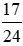

**Bài 9.31 trang 96 Toán lớp 6 Tập 2:**

Trong túi có một số viên bi màu đen và một số viên bi màu đỏ có cùng kích thước.

Thực hiện lấy ngẫu nhiên một viên bi từ túi, xem viên bi màu gì rồi trả lại viên bi vào túi. Khoa thực hiện thí nghiệm 30 lần. Số lần lấy được viên bi màu đỏ là 13. Hãy tính xác suất thực nghiệm của sự kiện Khoa lấy được viên bi màu đỏ.

Lời giải:

Xác suất thực nghiệm của sự kiện Khoa lấy được viên bi màu đỏ là: 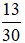

**Bài 9.32 trang 96 Toán lớp 6 Tập 2:**

Một chiếc thùng kín có một số quả bóng màu xanh, đỏ, tím, vàng có cùng kích thước. Trong một trò chơi, người chơi lấy ngẫu nhiên một quả bóng, ghi lại màu rồi trả lại bóng vào thùng. Bình thực hiện trò chơi 100 lần và được kết quả như bảng sau:

| Màu | Số lần |
| --- | --- |
| Xanh | 43 |
| Đỏ | 22 |
| Tím | 18 |
| Vàng | 17 |

Tính xác suất thực nghiệm của các sự kiện sau:

a) Bình lấy được quả bóng màu xanh;

b) Quả bóng được lấy ra không là màu đỏ.

Lời giải:

a) Xác suất thực nghiệm của các sự kiện Bình lấy được quả bóng màu xanh là:

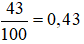

b) Để lấy ra được quả bóng không là màu đỏ nghĩa là lấy được các màu còn lại xanh, tím và vàng

Số lần lấy được quả bóng không phải là màu đỏ là: 100 – 22 = 78 (lần)

Xác suất thực nghiệm của các sự kiện quả bóng được lấy ra không là màu đỏ là: 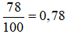

Vậy xác suất thực nghiệm của các sự kiện Bình lấy được quả bóng màu xanh; Quả bóng được lấy ra không là màu đỏ lần lượt là 0,43 và 0,78.

## Luyện tập chung trang 97
**Trò chơi xúc xắc trang 97 Toán lớp 6 Tập 2:**

Chuẩn bị: Hai con xúc xắc xanh và đỏ.

Cách chơi:

- Hai người chơi bốc thăm hoặc oẳn tù tì để chọn người chơi trước và mang tên E (Even number), người chơi sau mang tên O (Odd number).

- Hai người chơi lần lượt gieo đồng thời hai con xúc xắc. Ở mỗi lần gieo, nếu tích số chấm xuât hiện trên hai con xúc xắc là số lẻ thì O được 1 điểm, là số chẵn thì E được 1 điểm.

- Ai được 20 điểm trước là người thắng.

1. Em đọc luật chơi trên và dự đoán xem trong hai người chơi, ai là người có khả năng thắng cuộc cao hơn.

2. Chia lớp thành từng cặp hai người chơi. Mỗi cặp chơi một ván (tức là chơi đến lúc có người thắng) và ghi lại kết quả theo mẫu Bảng 9.9.

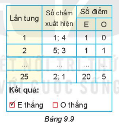

3. Tổng hợp lại kết quả chơi của cả lớp theo mẫu Bảng 9.10.

| Cặp chơi số | E thắng | O thắng |
| --- | --- | --- |
| 1 | X | |
| 2 | | X |
| … | | |

Bảng 9.10

4. Từ dữ liệu Bảng 9.10, hãy tính xác suất thực nghiệm của các sự kiện E thắng, O thắng. Dựa vào kết quả tính được, khả năng E hay O thắng là cao hơn? Dự đoán ban đầu của em có chính xác không?

Lời giải:

1. Dự đoán Even number (E) có khả năng thắng cuộc cao hơn.

2. Ví dụ về một cặp đôi chơi một ván:

| Lần tung | Số chấm xuất hiện | Số điểm |
| --- | --- | --- | --- |
| E | O |
| 1 | 1; 4 | 1 | 0 |
| 2 | 1; 5 | 1 | 1 |
| 3 | 2; 3 | 2 | 0 |
| 4 | 1; 6 | 3 | 0 |
| 5 | 3; 5 | 0 | 2 |
| 6 | 3; 4 | 4 | 0 |
| 7 | 3; 5 | 0 | 3 |
| 8 | 2; 6 | 5 | 0 |
| 9 | 3; 1 | 0 | 4 |
| 10 | 1; 6 | 6 | 0 |
| 11 | 2; 5 | 7 | 0 |
| 12 | 3; 4 | 8 | 0 |
| 13 | 3; 5 | 0 | 5 |
| 14 | 2; 5 | 9 | 0 |
| 15 | 2; 6 | 10 | 0 |
| 16 | 1; 5 | 0 | 6 |
| 17 | 3; 4 | 11 | 0 |
| 18 | 5; 6 | 12 | 0 |
| 19 | 1; 2 | 13 | 0 |
| 20 | 6; 5 | 14 | 0 |
| 21 | 1; 3 | 0 | 7 |
| 22 | 3; 5 | 0 | 8 |
| 23 | 4; 2 | 15 | 0 |
| 24 | 5; 6 | 16 | 0 |
| 25 | 1; 6 | 17 | 0 |
| 26 | 2; 3 | 18 | 0 |
| 27 | 5; 1 | 0 | 9 |
| 28 | 4; 6 | 19 | 0 |
| 29 | 6; 5 | 20 | 0 |
| Tổng điểm | | 20 | 8 |

Kết quả: E thắng.

3. Tổng hợp lại kết quả chơi của cả lớp 40 học sinh thì có 20 cặp chơi ở bảng 9.10.

| Cặp chơi số | E thắng | O thắng |
| --- | --- | --- |
| 1 | X | |
| 2 | X | |
| 3 | X | |
| 4 | X | |
| 5 | X | |
| 6 | | X |
| 7 | X | |
| 8 | X | |
| 9 | X | |
| 10 | X | |
| 11 | X | |
| 12 | X | |
| 13 | X | |
| 14 | X | |
| 15 | X | |
| 16 | X | |
| 17 | X | |
| 18 | X | |
| 19 | X | |
| 20 | X | |

4. Dựa vào bảng 9.10 ở trên:

Xác suất thực nghiệm của sự kiện E thắng là: 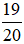

Xác suất thực nghiệm của sự kiện O thắng là: 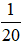

Vì 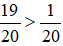 nên khả năng E thắng O.

Vậy dự đoán ban đầu là chính xác.

Giải thích hiểu rõ hơn vì sao khả năng E thắng cao hơn O:

Gọi dòng 1 là số chấm xuất hiện trên con xúc xắc màu xanh.

Cột 1 là số chấm xuất hiện trên con xúc xắc màu đỏ.

Các ô khác gồm 2 thông tin là: tích số chấm xuất hiện trên 2 con xúc xắc và kết quả luật chơi trong đó (O) là O thắng; (E) là E thắng.

| Số chấm | 1 | 2 | 3 | 4 | 5 | 6 |
| --- | --- | --- | --- | --- | --- | --- |
| 1 | 1(O) | 2(E) | 3(O) | 4(E) | 5(O) | 6(E) |
| 2 | 2(E) | 4(E) | 6(E) | 8(E) | 10(E) | 12(E) |
| 3 | 3(O) | 6(E) | 9(O) | 12(E) | 15(O) | 18(E) |
| 4 | 4(E) | 8(E) | 12(E) | 16(E) | 20(E) | 24(E) |
| 5 | 5(O) | 10(E) | 15(O) | 20(E) | 25(E) | 30(E) |
| 6 | 6(E) | 12(E) | 18(E) | 24(E) | 30(E) | 36(E) |

## Bài tập ôn cuối chương 9
**Bài 9.33 trang 98 Toán lớp 6 Tập 2:**

Nam muốn tìm kiếm thông tin để trả lời các câu hỏi dưới đây.

Em hãy gợi ý giúp Nam cách thu thập dữ liệu phù hợp cho mỗi câu hỏi:

a) Năm quốc gia nào có diện tích lớn nhất?

b) Có bao nhiêu bạn trong lớp có đồng hồ đeo tay?

c)Trong tuần trước, tổ nào trong lớp có nhiều lượt đi học muộn nhất?

Lời giải:

Học sinh có thể thu thập thông tin nhiều cách khác nhau. Dưới đây là ví dụ

a. Khảo sát qua mạng Internet

b. Quan sát trực tiếp các bạn trong lớp

c. Lập bảng thống kê từ tổ trưởng.

**Bài 9.34 trang 98 Toán lớp 6 Tập 2:**

Việt muốn tìm hiểu về đội bóng yêu thích của một số bạn nam. Em hãy giúp Việt:

a) Lập phiếu hỏi để thu thập dữ liệu;

b) Thu thập trong phạm vi lớp em và ghi lại kết quả dưới dạng bảng.

Từ kết quả thu được em có kết luận gì?

Lời giải:

a) Lập phiếu hỏi:

Bạn yêu thích đội bóng nào?

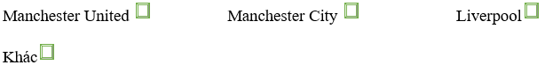

(Với mỗi dấu hỏi tích X vào 1 trong các lựa chọn)

b) Bảng thống kê số lượng học sinh yêu thích đội bóng của các bạn nam trong lớp.

Ví dụ ở một lớp 6 có 20 bạn nam.

| Đội bóng | Manchester United | Manchester City | Liverpool | Đội bóng khác |
| --- | --- | --- | --- | --- |
| Số học sinh | 10 | 5 | 3 | 2 |

Từ kết quả bảng ta thấy:

Số học sinh yêu thích đội Manchester United nhiều nhất là 10 chiếm một nửa số bạn nam trong lớp yêu thích.

**Bài 9.35 trang 98 Toán lớp 6 Tập 2:**

Một túi đựng 2 quả bóng màu xanh, 4 quả bóng màu vàng và 1 quả bóng màu đỏ có cùng kích thước. Nam lấy một quả bóng mà không nhìn vào túi

a) Quả bóng Nam lấy ra có thể có màu gì?

b) Em hãy lấy một quả bóng từ túi đó 20 lần, sau mỗi lần ghi lại xem quả bóng lấy được có màu gì rồi trả bóng lại túi trước khi lấy lần sau. Hoàn thiện bảng thống kê sau:

| Màu bóng | Xanh | Vàng | Đỏ |
| --- | --- | --- | --- |
| Số lần | ? | ? | ? |

c) Vẽ biểu đồ cột biểu diễn bảng thống kê trên

d) Tính xác suất thực nghiệm của các sự kiện Quả bóng lấy ra có màu

(1) xanh ; (2) vàng; (3) đỏ.

Lời giải:

a) Quả bóng Nam lấy ra có thể có màu: Xanh; Vàng; Đỏ.

b) Ví dụ khi thực hiện của một bạn nam lấy bóng từ túi, ta có được bảng thống kê dưới đây:

| Màu bóng | Xanh | Vàng | Đỏ |
| --- | --- | --- | --- |
| Số lần | 7 | 9 | 4 |

c)

d)

Xác suất thực nghiệm của các sự kiện Quả bóng lấy ra có màu xanh là: 

Xác suất thực nghiệm của các sự kiện Quả bóng lấy ra có màu vàng là: 

Xác suất thực nghiệm của các sự kiện Quả bóng lấy ra có màu đỏ là: 

**Bài 9.36 trang 98 Toán lớp 6 Tập 2:**

Bình khảo sát môn thể thao yêu thích của các bạn trong lớp, thu được kết quả như trong Bảng thống kê 9.11.

a) Vẽ biểu đồ cột kép biểu diễn bảng thống kê này;

b) Môn thể thao nào được các bạn nam yêu thích nhất? Môn thể thao nào được các bạn nữ yêu thích nhất?

| | Nữ | Nam |
| --- | --- | --- |
| Bóng đá | 3 | 6 |
| Cầu lông | 5 | 5 |
| Bơi lội | 7 | 2 |
| Bóng rổ | 1 | 3 |
| Khác | 0 | 2 |

Bảng 9.11

Lời giải:

a)

b)

+) Ở cột biểu đồ màu xanh dương thì cột bóng đá cao nhất nên môn thể thao được các bạn nam yêu thích nhất là: Bóng đá

+) Ở cột biểu đồ màu xanh lá cây thì cột bơi lội cao nhất nên môn thể thao được các bạn nữ yêu thích nhất là: Bơi lội.

**Bài 9.37 trang 98 Toán lớp 6 Tập 2:**

Minh bỏ 7 viên bi đen và 3 viên bi trắng có cùng kích thước vào một túi.

Mỗi lần Minh lấy ra ngẫu nhiên một viên bi từ túi, xem viên bi đó có màu gì rồi lại bỏ viên bi đó vào túi. Minh đã thực hiện 100 lần và thấy có 58 lần lấy được bi đen.

Tính xác suất thực nghiệm của sự kiện Minh lấy được viên bi màu đen.

Lời giải:

Xác suất thực nghiệm của sự kiện Minh lấy được viên bi màu đen là: 

Vậy xác suất thực nghiệm của sự kiện Minh lấy được viên bi màu đen là 0,58.

**Bài 9.38 trang 98 Toán lớp 6 Tập 2:**

Trong hộp có 5 phần thưởng gồm 2 chiếc bút chì và 3 chiếc bút bi. Quỳnh chọn ngẫu nhiên hai phần thưởng trong hộp. Em hãy liệt kê các kết quả có thể.

Lời giải:

Các kết quả có thể là: Bút chì và Bút bi; Bút chì và Bút chì; Bút bi và Bút bi.
